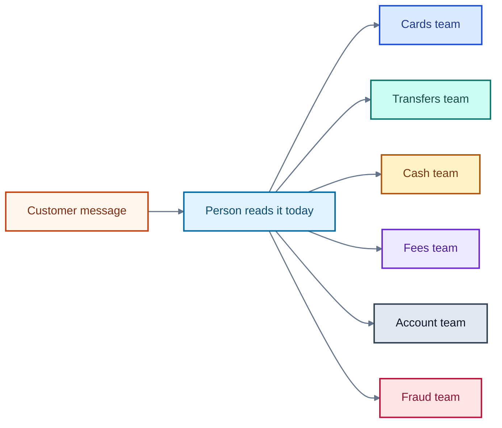
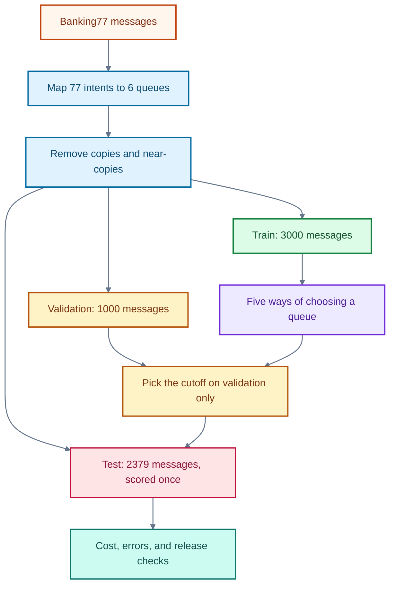
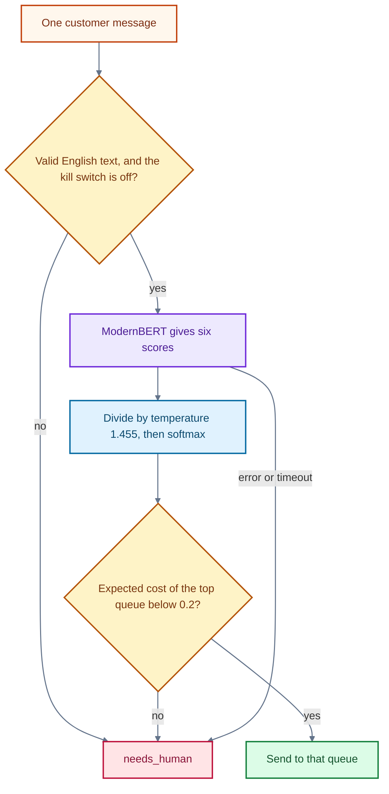

# How to train a decision model

A retail bank receives short messages from customers in chat, email, and the app. Someone has to send each message to the team that can act on it. This project trains a small **decision model**: a program that reads one message and picks one team from a fixed list. It never writes a reply.

The full rules are in [docs/spec-bank-routing-decision-model-2026-10-09.md](docs/spec-bank-routing-decision-model-2026-10-09.md). The costs below are illustrative. They are not a production approval, and the model is not released for live traffic.

## The winner

**ModernBERT with the expected-cost rule wins.**

The score that matters is the average pain of one message. Lower is better. A person handling every message costs 0.20. The simple word-count model costs 0.053. A useful system has to beat both, and it has to stop sending fraud messages to the wrong team.

ModernBERT is a text encoder trained on 3,000 bank messages. With a single confidence cutoff it costs 0.056 per message, which is worse than the simple model. The network alone is not the winner.

The winner is that same network plus a different hand-off. Instead of asking "is the top chance at least 0.86?", the service asks "is sending this message cheaper than handing it to a person?" A missed fraud costs five times a wrong team, and the rule uses that. Cost falls to **0.052**, the lowest of every method tried. Fraud sent to the wrong team falls from 5 of 235 to **1 of 235**.

The others lose for plain reasons:

- The simple word-count model (TF-IDF) is close on cost at 0.053, but it sends 6 fraud messages to the wrong team. The same cost rule makes it worse, at 0.064, because its chances were never made honest.
- LoRA on Qwen costs 0.142, and that number is only on 600 messages.
- Qwen with no training costs about the same as sending every message to a person.
- SetFit, trained on 48 examples, is right on only 67% of messages.

The winning weights are on Hugging Face: [raphaelmansuy/bank-routing-modernbert](https://huggingface.co/raphaelmansuy/bank-routing-modernbert). They are not stored in this git repository. The costs are still illustrative. This is not a production approval.

## The problem

Today a person reads each message and chooses a team. That is slow, people disagree, and a fraud message left in the wrong list can sit there while money is lost.

The six teams, called **queues**, are:

| Queue | What that team handles |
|---|---|
| `cards` | Card delivery, activation, PIN, a card that does not work |
| `transfers` | Bank transfers, card payments, refunds, pending or declined payments |
| `cash` | Top-ups, cash machines, cheque or cash deposits |
| `fees` | Fees, charges, and exchange rates |
| `account` | Identity checks, personal details, passcode, closing the account |
| `fraud` | Payments the customer does not recognise, a lost or stolen card or phone |

The model does not decide whether a payment is fraud. It only puts the message on the fraud team's list. It does not block cards, move money, or change accounts. It does not answer the customer.

If the model is unsure, or if anything goes wrong, the message goes to a person. That outcome is called `needs_human`. It is a safety rule, not a seventh answer the model is trained to give.



A mistake has a cost. The numbers are relative pain, not currency. A person looking at a ticket costs 0.2. A ticket sent to the wrong team costs 1.0. A real fraud message sent automatically to some other team costs 5.0, and that message is not also charged the 1.0. A correct automatic routing costs 0. Sending every message to a person costs exactly 0.2 per ticket. Any useful model has to beat that.

## The experiment

The messages come from **Banking77**, a public set of 13,083 English online-banking questions published by PolyAI. Each message already has one of 77 fine-grained topics, called **intents**. Examples are `card_arrival` and `lost_or_stolen_card`. The contract maps each intent to exactly one of the six queues. The licence is CC-BY-4.0: anyone may use the data if they credit the authors. Citation: Casanueva et al., "Efficient Intent Detection with Dual Sentence Encoders", arXiv 2003.04807.

We keep 3,000 messages to train on, 1,000 to make choices (the **validation** set), and 2,379 held-out messages that are scored once at the end (the **test** set). A **seed** is the fixed random starting point, here 42, so the split can be repeated. Seven exact copies were removed from the training file. Nine test messages were word-for-word copies of a training message, and 692 more were near-copies. A near-copy is a test message whose character pattern is 90% or more similar to a training message. Those were removed so the score is not flattered by messages the model has already seen. The other 5,996 training messages were left unused, to mimic a bank that has only a few thousand labelled examples.



Five methods were compared. Training of the neural models ran on [Modal](https://modal.com), a cloud service that rents a graphics processor for the job. The chip was an L4. **bf16** means the arithmetic used a shorter number format that is fast on that chip. The published demo of this method used an ordinary processor; this run records that difference.

1. **TF-IDF plus logistic regression.** TF-IDF turns text into word and character counts, down-weighting words that appear everywhere. Logistic regression is a simple formula that turns those counts into a chance for each queue. It trained in a few seconds on an ordinary processor. This is the baseline: the simple method the others have to beat.
2. **Zero-shot Qwen3-0.6B.** Qwen3-0.6B is a small language model, about 0.6 billion parameters, used with no training on these messages. A **logit** is the raw score the model gives a word before it is turned into a chance. We read only the scores for the six queue names, so the answer is always one of those six. This is the "no training" comparison.
3. **Route A, ModernBERT.** ModernBERT-base is a text encoder: it reads the message and produces a numeric summary. A **classification head** is a small final layer that turns that summary into six scores. We trained it for two passes over the 3,000 messages. This is the candidate we would ship.
4. **SetFit.** A few-shot method. It sees only 8 examples of each queue, 48 messages in total, and learns a small classifier on top of a sentence embedding. It is a way to start when labels are scarce. It is not a release candidate.
5. **Route B, LoRA on Qwen3-0.6B.** LoRA (low-rank adaptation) trains a few small added matrices and leaves the rest of the language model frozen. This run used 240 messages and 60 training steps, then read the six queue-name scores. The score is on 600 test messages, not the full 2,379, and the report says so.

After training, two numbers are fitted on the validation messages only.

**Temperature** is one number, T. Every raw score is divided by T before the scores are turned into chances. The conversion is called **softmax**: the chances are positive and add up to 1. Temperature makes the chances more honest. It does not change which queue is in first place. For ModernBERT, T is 1.455. It was fitted on validation only.

**Confidence** is the chance of the leading queue. The first experiment also fitted a **threshold**, or cutoff: the confidence below which the message goes to a person. Every cutoff from 0.00 to 1.00 was tried on validation, and 0.86 had the lowest cost. That number is kept in the report. It is not what the service uses now.

A single cutoff treats every mistake as the same kind of mistake. The cost table does not. Sending a real fraud message to another team costs 5.0. Sending any other message to the wrong team costs 1.0. A person costs 0.2. ModernBERT's chances are already honest enough to use that table directly. **Expected cost** of the leading queue is the average pain of sending the message there:

- If the leader is not fraud: the chance it is wrong, times 1.0, plus the chance it really is fraud, times an extra 4.0. The extra 4.0 is the gap between 5.0 and the 1.0 already counted.
- If the leader is fraud: the chance it is not fraud, times 1.0. This contract does not add an extra charge for a false trip to the fraud team.

The message is sent only when that number is strictly below 0.2. Otherwise a person sees it. Written as a shortcut: a non-fraud leader needs its chance, minus four times the fraud chance, to be above 0.8. A fraud leader needs its own chance above 0.8. There is no new number to search for. The same rule, with the same costs, is what `decide()` runs.

Under these costs it never pays to send the message to a queue that is not in first place. A false send costs the same in every queue, so the fraud queue is worth an automatic send only when it is already the leader. On the validation set and on the test set, the number of messages sent to some other queue is 0.



## The result

Measured on the 2,379 test messages, unless a row says otherwise. The 0.86 cutoff was chosen on validation. The expected-cost rows use the contract costs and the saved chances. Nothing in those rows was tuned on the test set.

| Method | Share sent without a person | Errors among those | Fraud sent to the wrong team | Cost per ticket |
|---|---|---|---|---|
| ModernBERT, expected cost | 82.5% | 1.8% | 1 of 235 | 0.052 |
| ModernBERT, cutoff 0.86 | 84.4% | 1.9% | 5 of 235 | 0.056 |
| TF-IDF, cutoff 0.69 | 87.6% | 2.0% | 6 of 235 | 0.053 |
| TF-IDF, expected cost | 71.7% | 0.8% | 1 of 235 | 0.064 |
| LoRA on Qwen, 600 messages only | 63.8% | 5.7% | 5 of that subset | 0.142 |
| Zero-shot Qwen, no training | 1.1% | 11.5% | 1 of 235 | 0.201 |
| SetFit, 48 training examples | scored as a classifier only |  |  | accuracy 66.9% |
| Every message to a person | 0% |  | 0 | 0.200 |

ModernBERT's top pick is right on 94.2% of test messages. Averaging the per-queue F1 score gives 0.941. F1 is the balance of precision and recall for one queue. **Precision** asks: of the messages sent to this queue, how many belonged there? **Recall** asks: of the messages that belonged there, how many were sent there? **Macro-F1** averages the six F1 scores so the small fraud queue counts as much as the large cards queue. Recall before the hand-off was cards 0.936, transfers 0.951, cash 0.932, fees 0.943, account 0.967, and fraud 0.928.

**ECE** (expected calibration error) is how far confidence sits from reality. After temperature scaling it is 0.012 on the test set: when the model says it is sure, it usually is. **NLL** (negative log-likelihood) is the penalty for putting a low chance on the right queue. Lower is better. ModernBERT's test NLL is 0.196.

The zero-shot model is right on only 31.3% of messages. After calibration it is cautious, so it auto-routes almost nothing and costs about the same as sending everything to a person. SetFit, with 48 examples, reaches 66.9% accuracy. LoRA reaches 83.0% accuracy, but only on its 600-message slice, and it costs more.

The cutoff fails two release checks. The expected-cost rule meets the same numbers, on the same frozen chances:

- At the 0.86 cutoff, ModernBERT costs 0.056 per ticket. That beats "send everything to a person" (0.200) and sits under the proposed cap of 0.07, but it does not beat TF-IDF at its own cutoff (0.053). With expected cost, ModernBERT costs 0.052. That is under the cap and under the TF-IDF cutoff. TF-IDF under the same expected-cost rule costs 0.064. Its chances were never corrected with a temperature, so the formula is too harsh on it. The gain belongs to the calibrated model, used with the cost table.
- At the cutoff, five fraud messages were sent to another queue: 2.1% of 235, against a proposed limit of 1.5%. Catch rate 97.9%, against a proposed 99%. Expected cost sends one fraud message to the wrong queue (0.4%) and catches 99.6%, because the other four are handed to a person. On validation, before the test score, the same rule missed 1 of 98 fraud messages and cost 0.054 per ticket.

The rule is not more cautious on every message. Of the 2,379 test messages, 80 would have been sent at 0.86 and are now held, and 34 that the cutoff would have held are now sent. One of the held messages is "Can I freeze my card right now?". The true queue is fraud. The model puts cards first at 0.88, with a 0.11 chance of fraud. The cutoff would have sent it to cards. The expected cost of that send is 0.55, which is worse than a person, so a person still sees it.

The other measured checks pass either way: no leaked copies in the test set, recall of the other queues at least 0.90, macro-F1 at least 0.92, calibration, an auto-route rate of at least 70%, an accepted error of at most 2%, similar scores on short and long messages, and a serving check. Business sign-off of the costs is still open. If the 5.0 changes, this rule changes with it. That is the point of writing the costs into the decision instead of hiding them inside one cutoff.

The exported file format is **ONNX**. ONNX Runtime runs it on an ordinary processor. On 300 test messages the exported file picks the same queue as the original model every time. The largest score difference is about 0.0001. Half the messages are scored within 19 milliseconds, and 95% within 30 milliseconds.

Two real messages from a local check of that file:

- "Why was I charged extra when I paid in euros?" goes to `fees` with confidence 0.9998. The fraud chance is tiny, so the expected cost is far below 0.2.
- "I lost my card on the bus this morning" has top label `fraud` at 0.66. A fraud leader is sent on only when that chance is above 0.8, so a person still sees it. A lost card belongs with the fraud team. The cost rule is what keeps this call from being sent on alone.

Business sign-off of the costs, the fraud limit, and the model card is still open. The run used one seed. The messages are public Banking77 phrasing, not a bank's own customers.

## Words used here

| Word | Meaning in this project |
|---|---|
| Queue | One team's work list. The six names above. |
| Intent | One of the 77 Banking77 topics, mapped to one queue. |
| `needs_human` | A person must route this message. Produced by a rule, not learned. |
| Decision model | Returns one label from a fixed list, plus a chance for each label. |
| Validation set | 1,000 messages used to choose the cutoff and the temperature. |
| Test set | 2,379 messages scored once, after those choices were frozen. |
| Seed | Fixed random start, so a split or a training run can be repeated. |
| TF-IDF | Word and character counts, down-weighted when they are common. |
| Logistic regression | A simple classifier on top of those counts. |
| Logit | A raw score, before it becomes a chance. |
| Softmax | Turns six scores into six chances that add up to 1. |
| Temperature | One number that divides the scores before softmax. Fitted on validation. |
| Confidence | The chance of the leading queue. |
| Threshold | The first experiment's confidence cutoff, 0.86. Recorded, and no longer the rule the service acts on. |
| Expected cost | Average pain of sending to the leading queue, using 0.2, 1.0, and 5.0. Send only when this is below 0.2. |
| Precision | Of messages sent to a queue, the share that belonged there. |
| Recall | Of messages that belonged to a queue, the share that were sent there. |
| F1 | The balance of precision and recall for one queue. |
| Macro-F1 | The plain average of the six F1 scores. |
| ECE | Expected calibration error. How far confidence is from the actual hit rate. |
| NLL | Negative log-likelihood. Penalty for a low chance on the right queue. |
| Encoder | A model that turns text into a numeric summary. ModernBERT is one. |
| Classification head | The last layer that turns that summary into six scores. |
| LoRA | Small trainable add-ons on a frozen language model. |
| Zero-shot | Using a language model with no training on this task. |
| SetFit | Few-shot training: a handful of examples per queue. |
| bf16 | A short floating-point format used to train faster on the graphics chip. |
| ONNX | A file format so the model can run without the training software. |
| Modal | The cloud service that ran the training on an L4 graphics chip. |
| CC-BY-4.0 | The Banking77 licence: use is allowed with credit to the authors. |

## Run it again

```bash
python3 -m venv .venv
source .venv/bin/activate
pip install -r requirements.txt
modal setup
modal run modal_app.py
```

`modal run` trains in the cloud, then copies the report and the model bundle back into this folder. If Modal is not logged in, the command stops. It does not train on this machine.

The winning ModernBERT weights, and the ONNX file used for serving, are published at [raphaelmansuy/bank-routing-modernbert](https://huggingface.co/raphaelmansuy/bank-routing-modernbert).

To serve the exported model locally:

```bash
pip install -e ".[serve]"
python serve.py
```

`POST /v1/route` returns a queue or `needs_human`. A file named `KILL_SWITCH` in this folder, or the environment variable `BANK_ROUTING_KILL_SWITCH=1`, sends every message to a person without a new deploy.

`pytest` runs the local checks. The numbered scripts `01_prepare_data.py` through `07_ship.py` are the same steps the cloud job runs.
