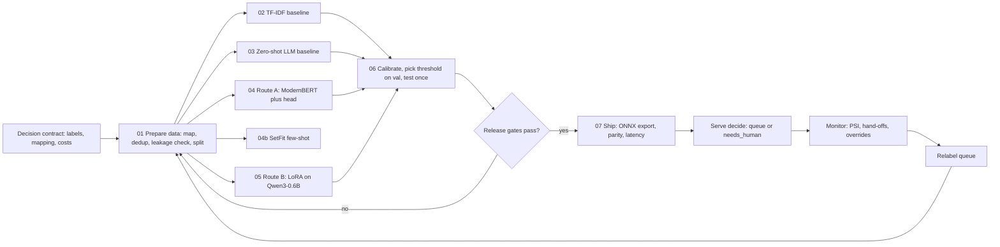
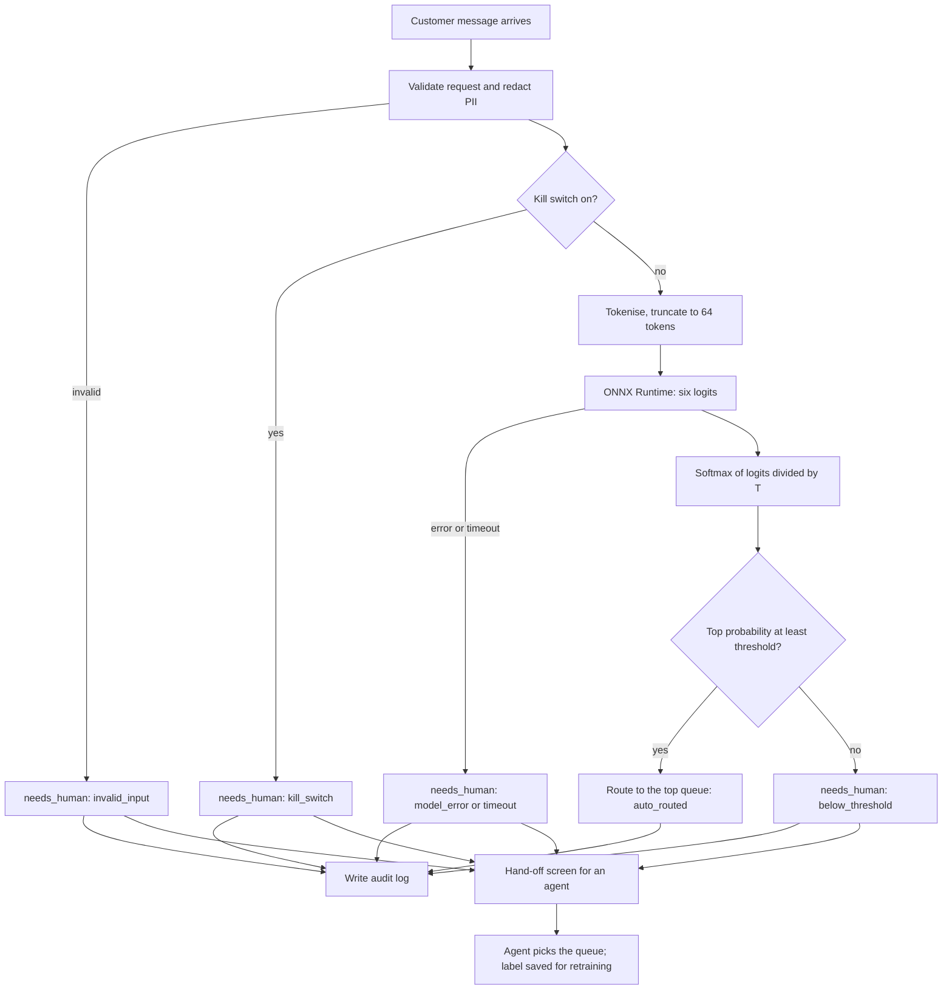
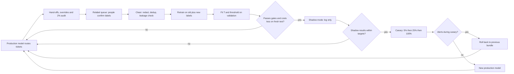

# Engineering specification: bank message routing decision model

| Field | Value |
|---|---|
| Document | spec-bank-routing-decision-model-2026-10-09.md |
| Version | 0.1 (draft for review) |
| Date | 9 October 2026 |
| Author | Raphael Mansuy |
| Status | Draft. Not approved for build. |
| Companion material | Slide deck "How to train a decision model: Application in Banking and Finance". Ideas Lab article "How to train a decision model". Demo code in `decision-model-demo/`. |

## How to read this document

- Each requirement has an ID, such as `DATA-07`. Use the ID in tickets, tests and reviews.
- **MUST** means the release is blocked if the requirement is not met.
- **SHOULD** means do it unless there is a written reason not to. Record the reason in the decision log.
- **MAY** means optional.
- Text marked **Proposed** is a suggestion from this document. It is not a measured result. The business or the named owner must confirm it before build.
- Text marked **Demo** is a fact taken from the demo code or its `results/` files. The demo is **one small run on one CPU machine, run once, with one seed**. Demo numbers show how the method behaves. They are not a benchmark and they are not a promise of production results.
- Every section ends with acceptance criteria. A section is done when all of its acceptance criteria pass.

---

## 1. Purpose, scope, non-goals and glossary

### 1.1 Purpose

A retail bank receives short customer messages through chat, email and the app. Each message must reach the team that can act on it. Today a person reads each message and picks a team. This is slow, people disagree, and a fraud message left in the wrong queue can cost money.

This specification describes how to build, test, ship and run a small **decision model**. The model reads one message and returns one of six queues, or hands the message to a person when it is not sure enough. The six queues are `cards`, `transfers`, `cash`, `fees`, `account` and `fraud`. The hand-off route is `needs_human`.

The worked example uses Banking77, a public set of online-banking messages. The same steps apply to the bank's own messages later.

### 1.2 Scope

In scope:

1. The decision contract: labels, queue scopes, intent mapping, input and output schemas, hand-off rule and costs.
2. Data: sources, labelling, checks, splits and data cards.
3. Baselines: a zero-shot small language model and TF-IDF with logistic regression.
4. Training: route A (encoder with a classification head), route B (LoRA on a small language model) and a few-shot option (SetFit).
5. Evaluation: per-class scores, calibration, the cost-based hand-off threshold and release gates.
6. Serving: the `decide()` logic, the API, latency, ONNX export and the human hand-off.
7. Monitoring and retraining: drift, hand-off and override rates, the relabel queue, rollout and rollback.
8. Risk and governance: ownership, audit logs, explanations for agents, fairness checks, model card and human oversight.
9. Project plan and RACI.

### 1.3 Non-goals

1. The model does not write replies to customers. It only picks a queue.
2. The model does not decide whether a payment is fraud. It only sends the message to the fraud team. Fraud decisions stay with the fraud team and its own systems.
3. The model does not block cards, move money or change accounts.
4. Version 1 does not handle languages other than English. Banking77 is English only.
5. Version 1 does not handle attachments, images or voice.
6. Version 1 does not have an "out of scope" class. Messages outside the six queues go to a person through the hand-off rule (see `CON-14`).
7. This document does not claim compliance with any law or regulation (see section 10.8).

### 1.4 Glossary

| Term | Plain definition |
|---|---|
| Decision model | A model that returns one answer from a fixed list, plus a score for each answer. It never writes free text. |
| Label | One allowed answer. Here a label is one of the six queues. |
| Queue | A team's work list, such as `fraud`. In this document queue and label mean the same thing. |
| Intent | One of the 77 fine-grained topics in Banking77, such as `card_arrival`. Each intent maps to exactly one queue. |
| Route | The final output that the system acts on. It is a queue or `needs_human`. |
| Decision contract | The written rules: the labels, what each label covers, the hand-off rule, the input and output format and the cost of each kind of mistake. |
| Abstain or hand-off | The model declines to route automatically. The message goes to a person. The output route is `needs_human`. |
| `needs_human` | The hand-off route. It is produced by a rule, not learned as a class. |
| Logits | The raw scores the model gives each label before they are turned into probabilities. |
| Softmax | The formula that turns logits into probabilities that add up to 1. |
| Confidence | The highest probability among the six labels. |
| Threshold (cut-off) | The confidence below which the message is handed to a person. Demo value: 0.94. |
| Calibration | How well confidence matches reality. If the model says 90% on 100 messages, about 90 should be right. |
| Temperature scaling | A calibration method. Divide all logits by one number, T, before softmax. T is fitted on validation data. It does not change which label wins. |
| NLL (negative log-likelihood, log loss) | A score of how much probability the model gave to the right answer. Lower is better. |
| ECE (expected calibration error) | The weighted average gap between confidence and accuracy across confidence bins. Lower is better. Formula in section 7.4. |
| Reliability diagram | A chart of accuracy against confidence, one point per confidence bin. A calibrated model sits on the diagonal. |
| Precision | Of the messages the model sent to a queue, the share that belonged there. |
| Recall | Of the messages that belonged to a queue, the share the model sent there. |
| F1 | The harmonic mean of precision and recall for one class. |
| Macro-F1 | The plain average of F1 over the six classes. Each class counts the same, so small classes like `fraud` matter. |
| Confusion matrix | A table of true label (rows) against predicted label (columns). It shows which queues get mixed up. |
| Auto-route rate (coverage) | The share of messages routed without a person. |
| Accepted error | Of the messages routed without a person, the share sent to the wrong queue. |
| Missed fraud | A true fraud message that was routed automatically to a queue other than `fraud`. |
| Fraud catch rate | The share of true fraud messages that reached either the `fraud` queue or a person. |
| Cost per ticket | The average cost of the routing outcome per message, using the cost table in section 2.2. |
| Leakage | Test messages that also appear, or nearly appear, in training data. It makes scores look better than they are. |
| Near-duplicate | Two messages whose character n-gram TF-IDF cosine similarity is 0.90 or more (the demo rule). |
| Drift | A change over time in the messages or in the model's outputs, compared with a reference period. |
| PSI (population stability index) | A number that measures how much a distribution has shifted. Formula in section 9.2. |
| Shadow mode | The model runs on live traffic and logs its answer, but people still route every message. |
| Canary | Live routing for a small share of traffic first, then more. |
| Encoder | A model that reads text and produces a vector. A classification head on top turns the vector into six logits. Route A uses ModernBERT-base. |
| LoRA | Low-rank adaptation. Small trainable matrices added to a frozen model. Route B trains LoRA on Qwen3-0.6B. |
| SFT | Supervised fine-tuning. Training a language model on prompt and answer pairs. |
| Logit read | Reading the next-token logits of a language model for the six label tokens only. It always returns a valid label. |
| SetFit | A few-shot method that fine-tunes a sentence-embedding model with pairs, then fits a small classifier. |
| ONNX | An open file format for models. ONNX Runtime runs it on CPU. |
| Parity check | A test that the exported ONNX model gives the same answers as the original model. |
| Model bundle | The set of files that must ship together: model weights, tokenizer, temperature, threshold, label order and contract version. |
| Data card, model card | Short documents that describe a dataset or a model: source, use, limits, scores and owners. |

### 1.5 End-to-end pipeline

Each box names the demo script that does the step.



SetFit (04b) writes test probabilities only. It is not part of the threshold comparison in step 06.

### 1.6 Requirements

- `GEN-01` The system **MUST** return exactly one route per message, from the seven allowed routes in section 3.
- `GEN-02` The system **MUST** fail safe. Any error, timeout or invalid output **MUST** produce `needs_human`.
- `GEN-03` The team **MUST** keep a decision log of choices that change the contract, the data, the threshold or the model.
- `GEN-04` Every number in reports and model cards **MUST** state the data split and the number of messages it was measured on.

### 1.7 Acceptance criteria

- [ ] The business owner, the fraud operations lead and the ML lead have read and signed off sections 1 to 3.
- [ ] The glossary terms are used the same way in code comments, dashboards and the model card.
- [ ] Non-goals are listed in the model card under "out of scope uses".

---

## 2. Business problem and success metrics

### 2.1 The problem

1. Messages keep coming in. Customers write about lost cards, failed transfers, top-ups and payments they did not make.
2. Someone has to sort them. A person reads each message and sends it to the team that can fix it.
3. Mistakes cost money. A fraud message left in a general queue waits. Money can be lost, and the customer gets angry. A message in the wrong queue bounces between teams.

### 2.2 The cost model

The demo uses the cost table below (from `common.py`). The values are **illustrative**. They express relative pain, not currency. **The business owner MUST set the real values** before the threshold is chosen for production.

| Outcome | Symbol | Demo cost | Meaning |
|---|---|---|---|
| Hand-off to a person | `COST_HUMAN` | 0.2 | A person triages the ticket. |
| Wrong queue | `COST_WRONG` | 1.0 | The ticket lands in the wrong queue and bounces. |
| Missed fraud | `COST_MISSED_FRAUD` | 5.0 | A true fraud ticket is auto-routed somewhere else. |
| Right queue, routed automatically | none | 0 | No extra cost. |

Cost per ticket for a set of N messages:

```
cost_per_ticket = (0.2 * H + 1.0 * W + 5.0 * F) / N
```

where H is the number of hand-offs, W is the number of wrong automatic routes that are not missed fraud, and F is the number of missed fraud messages. A missed fraud message counts once, at 5.0, not also at 1.0. Sending everything to people costs exactly 0.2 per ticket. That is the ceiling any model must beat.

Note: the demo does not charge extra when a non-fraud message is wrongly sent to `fraud`. The business **SHOULD** decide whether that case needs its own cost (see `BIZ-03`).

### 2.3 Demo anchor numbers

Demo. Test set of 2,379 messages unless stated. Threshold chosen on validation, applied once on test. Source: `results/06_calibration_abstain.json`.

| Model | Auto-route rate | Accepted error | Missed fraud | Cost per ticket |
|---|---|---|---|---|
| TF-IDF + logistic regression (threshold 0.69) | 87.6% | 2.0% | 6 | 0.0525 |
| ModernBERT-base, temperature scaled (threshold 0.94) | 72.6% | 1.2% | 2 | 0.0665 |
| LoRA Qwen3-0.6B, temperature scaled (threshold 0.94), 600-message test subset | 51.7% | 3.9% | 2 | 0.1300 |
| Zero-shot Qwen3-0.6B, temperature scaled (threshold 0.46) | 2.9% | 24.6% | 4 | 0.2081 |
| Everything to people | 0% | n/a | 0 | 0.2000 |

ModernBERT per-class recall on test (top-1, before hand-off): cards 0.917, transfers 0.949, cash 0.922, fees 0.933, account 0.958, fraud 0.885. Fraud catch rate with the 0.94 threshold: 233 of 235 fraud messages reached `fraud` or a person (99.1%).

The demo shows a real trade-off. The cheap TF-IDF model had the lowest cost per ticket, but it let 6 fraud messages through. ModernBERT let 2 through. Which one ships depends on the missed-fraud gate the business sets (`BIZ-02`).

### 2.4 Success metrics and targets

All targets in this table are **Proposed**. They are anchored to the demo and must be re-set after shadow mode on the bank's own traffic (`BIZ-05`).

| ID | Metric | Measured on | Proposed target | Demo anchor |
|---|---|---|---|---|
| T1 | Cost per ticket | Frozen test set | at most 0.07, and lower than the TF-IDF baseline cost or justified in the decision log | 0.0665 (ModernBERT), 0.0525 (TF-IDF) |
| T2 | Auto-route rate | Frozen test set | at least 70% | 72.6% |
| T3 | Accepted error | Frozen test set | at most 2.0% | 1.2% |
| T4 | Missed fraud | Frozen test set | at most 1.5% of true fraud messages (3 of 235 on a demo-size test set) | 2 of 235 (0.85%) |
| T5 | Fraud catch rate | Frozen test set | at least 99% | 99.1% |
| T6 | Fraud recall, top-1 | Frozen test set | at least 0.88 | 0.885 |
| T7 | Recall floor, every other queue, top-1 | Frozen test set | at least 0.90 | lowest is cards, 0.917 |
| T8 | Macro-F1 | Frozen test set | at least 0.92 | 0.927 |
| T9 | ECE, 15 bins, after temperature scaling | Frozen test set | at most 0.02 | 0.0096 |
| T10 | Model latency, batch 1, CPU, 4 threads | 300 test messages | p50 at most 30 ms, p95 at most 50 ms | p50 23.1 ms, p95 41.1 ms (ONNX Runtime) |
| T11 | Live override rate on auto-routed tickets | Production, weekly | at most 3% | not measured in demo |
| T12 | Live hand-off rate | Production, daily | within 5 points of the rate chosen at release | 27.4% on demo test |

### 2.5 Requirements

- `BIZ-01` The business owner **MUST** approve the three cost values in writing before the production threshold is chosen. The approved values **MUST** be stored in the contract file, not in code.
- `BIZ-02` The fraud operations lead **MUST** approve the missed-fraud gate (T4) and the fraud catch rate gate (T5).
- `BIZ-03` The business **SHOULD** decide whether a false send to `fraud` has its own cost. If yes, the cost function in `common.py` **MUST** be extended and the change logged.
- `BIZ-04` The team **MUST** report cost per ticket for the release candidate, the TF-IDF baseline and "everything to people" side by side, on the same test set.
- `BIZ-05` Targets T1 to T12 **MUST** be reviewed after shadow mode, using the bank's own labelled traffic.
- `BIZ-06` The team **SHOULD** report cost per ticket under at least two other cost tables (for example missed fraud at 2.0 and at 20.0) to show how sensitive the choice is. **Proposed**.

### 2.6 Acceptance criteria

- [ ] Signed cost table stored in the contract file with its version.
- [ ] Targets T1 to T12 approved, or replaced with approved values, and recorded in the decision log.
- [ ] A one-page report shows the release candidate against the TF-IDF baseline and "everything to people" on cost per ticket, auto-route rate, accepted error and missed fraud.

---

## 3. Decision contract

### 3.1 Label set and queue scope

The model has six trained labels. The order below is the index order used by the model head, the logits files and `data/contract.json`. Code **MUST** read the order from the contract file and never hard-code it. (The slide deck lists the queues in a different display order. Display order does not matter. Index order does.)

| Index | Label | Scope (what the queue handles) |
|---|---|---|
| 0 | `cards` | Card delivery, activation, PIN, card not working, virtual or physical cards |
| 1 | `transfers` | Bank transfers, card payments, refunds, pending or declined payments |
| 2 | `cash` | Top-ups, ATM and cash withdrawals, cheque or cash deposits |
| 3 | `fees` | Fees, charges and exchange rates |
| 4 | `account` | Identity checks, personal details, passcode, closing the account |
| 5 | `fraud` | Unrecognised transactions, lost or stolen card or phone, compromised card |
| none | `needs_human` | Not a trained label. Produced by the hand-off rule when confidence is below the threshold, or on any error. |

The scope text above is the `DESCR` dictionary in `llm_common.py`. Route B and the zero-shot baseline put it in the prompt, so a change to the scope text is a change to those models' input.

### 3.2 Banking77 intent to queue mapping

All 77 Banking77 intents map to exactly one queue. The mapping is the `ROUTES` dictionary in `01_prepare_data.py`, saved to `data/contract.json`. `01_prepare_data.py` asserts that no intent is unmapped and that there are exactly 77. Intent names are copied exactly, including the capital letter in `Refund_not_showing_up` and the question mark in `reverted_card_payment?`, because that is how they appear in the source CSV files.

Counts: cards 21, transfers 15, cash 13, fees 12, account 9, fraud 7. Total 77.

| # | Banking77 intent | Queue |
|---|---|---|
| 1 | `activate_my_card` | `cards` |
| 2 | `card_about_to_expire` | `cards` |
| 3 | `card_acceptance` | `cards` |
| 4 | `card_arrival` | `cards` |
| 5 | `card_delivery_estimate` | `cards` |
| 6 | `card_linking` | `cards` |
| 7 | `card_not_working` | `cards` |
| 8 | `card_swallowed` | `cards` |
| 9 | `change_pin` | `cards` |
| 10 | `contactless_not_working` | `cards` |
| 11 | `disposable_card_limits` | `cards` |
| 12 | `get_disposable_virtual_card` | `cards` |
| 13 | `get_physical_card` | `cards` |
| 14 | `getting_spare_card` | `cards` |
| 15 | `getting_virtual_card` | `cards` |
| 16 | `order_physical_card` | `cards` |
| 17 | `pin_blocked` | `cards` |
| 18 | `virtual_card_not_working` | `cards` |
| 19 | `visa_or_mastercard` | `cards` |
| 20 | `supported_cards_and_currencies` | `cards` |
| 21 | `apple_pay_or_google_pay` | `cards` |
| 22 | `balance_not_updated_after_bank_transfer` | `transfers` |
| 23 | `beneficiary_not_allowed` | `transfers` |
| 24 | `cancel_transfer` | `transfers` |
| 25 | `declined_transfer` | `transfers` |
| 26 | `failed_transfer` | `transfers` |
| 27 | `pending_transfer` | `transfers` |
| 28 | `receiving_money` | `transfers` |
| 29 | `transfer_into_account` | `transfers` |
| 30 | `transfer_not_received_by_recipient` | `transfers` |
| 31 | `transfer_timing` | `transfers` |
| 32 | `declined_card_payment` | `transfers` |
| 33 | `pending_card_payment` | `transfers` |
| 34 | `reverted_card_payment?` | `transfers` |
| 35 | `Refund_not_showing_up` | `transfers` |
| 36 | `request_refund` | `transfers` |
| 37 | `atm_support` | `cash` |
| 38 | `automatic_top_up` | `cash` |
| 39 | `balance_not_updated_after_cheque_or_cash_deposit` | `cash` |
| 40 | `declined_cash_withdrawal` | `cash` |
| 41 | `pending_cash_withdrawal` | `cash` |
| 42 | `pending_top_up` | `cash` |
| 43 | `top_up_by_cash_or_cheque` | `cash` |
| 44 | `top_up_failed` | `cash` |
| 45 | `top_up_limits` | `cash` |
| 46 | `top_up_reverted` | `cash` |
| 47 | `topping_up_by_card` | `cash` |
| 48 | `verify_top_up` | `cash` |
| 49 | `wrong_amount_of_cash_received` | `cash` |
| 50 | `card_payment_fee_charged` | `fees` |
| 51 | `card_payment_wrong_exchange_rate` | `fees` |
| 52 | `cash_withdrawal_charge` | `fees` |
| 53 | `exchange_charge` | `fees` |
| 54 | `exchange_rate` | `fees` |
| 55 | `exchange_via_app` | `fees` |
| 56 | `extra_charge_on_statement` | `fees` |
| 57 | `fiat_currency_support` | `fees` |
| 58 | `top_up_by_bank_transfer_charge` | `fees` |
| 59 | `top_up_by_card_charge` | `fees` |
| 60 | `transfer_fee_charged` | `fees` |
| 61 | `wrong_exchange_rate_for_cash_withdrawal` | `fees` |
| 62 | `age_limit` | `account` |
| 63 | `country_support` | `account` |
| 64 | `edit_personal_details` | `account` |
| 65 | `passcode_forgotten` | `account` |
| 66 | `terminate_account` | `account` |
| 67 | `unable_to_verify_identity` | `account` |
| 68 | `verify_my_identity` | `account` |
| 69 | `why_verify_identity` | `account` |
| 70 | `verify_source_of_funds` | `account` |
| 71 | `card_payment_not_recognised` | `fraud` |
| 72 | `cash_withdrawal_not_recognised` | `fraud` |
| 73 | `compromised_card` | `fraud` |
| 74 | `direct_debit_payment_not_recognised` | `fraud` |
| 75 | `lost_or_stolen_card` | `fraud` |
| 76 | `lost_or_stolen_phone` | `fraud` |
| 77 | `transaction_charged_twice` | `fraud` |

### 3.3 Input schema

The request body for one message. The fields beyond `text` are **Proposed**. The demo `decide()` takes only `text`.

```json
{
  "$schema": "https://json-schema.org/draft/2020-12/schema",
  "$id": "https://example.internal/schemas/route-request/1.0.0",
  "title": "RouteRequest",
  "type": "object",
  "additionalProperties": false,
  "required": ["message_id", "text"],
  "properties": {
    "message_id": {
      "type": "string",
      "minLength": 1,
      "maxLength": 128,
      "description": "Caller's unique ID for the message. Used for idempotency and audit."
    },
    "text": {
      "type": "string",
      "minLength": 1,
      "maxLength": 2000,
      "description": "The customer's message as received. Must contain at least one non-space character."
    },
    "channel": {
      "type": "string",
      "enum": ["chat", "email", "app", "web_form", "other"],
      "description": "Where the message came from. Used for monitoring slices, not as a model input in v1."
    },
    "locale": {
      "type": "string",
      "pattern": "^[a-z]{2}(-[A-Z]{2})?$",
      "description": "Language tag, for example en or en-GB. v1 supports English only."
    },
    "received_at": {
      "type": "string",
      "format": "date-time",
      "description": "When the bank received the message, ISO 8601 with offset."
    }
  }
}
```

### 3.4 Output schema

The demo output has five fields: `route`, `label`, `confidence`, `probabilities` and `threshold`. Those five are required. The other fields are **Proposed** additions for audit and rollback.

```json
{
  "$schema": "https://json-schema.org/draft/2020-12/schema",
  "$id": "https://example.internal/schemas/route-decision/1.0.0",
  "title": "RouteDecision",
  "type": "object",
  "additionalProperties": false,
  "required": ["route", "label", "confidence", "probabilities", "threshold"],
  "properties": {
    "route": {
      "type": "string",
      "enum": ["cards", "transfers", "cash", "fees", "account", "fraud", "needs_human"],
      "description": "What the system acts on. Equals label when confidence >= threshold, else needs_human."
    },
    "label": {
      "type": ["string", "null"],
      "enum": ["cards", "transfers", "cash", "fees", "account", "fraud", null],
      "description": "The model's top label. Null only when the model did not run (error or timeout)."
    },
    "confidence": {
      "type": ["number", "null"],
      "minimum": 0,
      "maximum": 1,
      "description": "Top probability after temperature scaling."
    },
    "probabilities": {
      "type": ["object", "null"],
      "additionalProperties": false,
      "required": ["cards", "transfers", "cash", "fees", "account", "fraud"],
      "properties": {
        "cards": {"type": "number", "minimum": 0, "maximum": 1},
        "transfers": {"type": "number", "minimum": 0, "maximum": 1},
        "cash": {"type": "number", "minimum": 0, "maximum": 1},
        "fees": {"type": "number", "minimum": 0, "maximum": 1},
        "account": {"type": "number", "minimum": 0, "maximum": 1},
        "fraud": {"type": "number", "minimum": 0, "maximum": 1}
      },
      "description": "Probability for each of the six labels, after temperature scaling. Sums to 1 within rounding."
    },
    "threshold": {
      "type": "number",
      "minimum": 0,
      "maximum": 1,
      "description": "The hand-off threshold in force for this decision."
    },
    "reason": {
      "type": "string",
      "enum": ["auto_routed", "below_threshold", "model_error", "timeout", "invalid_input", "kill_switch"],
      "description": "Proposed. Why this route was chosen."
    },
    "message_id": {"type": "string", "description": "Proposed. Echo of the request ID."},
    "request_id": {"type": "string", "description": "Proposed. Server-side ID for the log line."},
    "contract_version": {"type": "string", "pattern": "^\\d+\\.\\d+\\.\\d+$", "description": "Proposed."},
    "model_version": {"type": "string", "description": "Proposed. Model bundle ID from the registry."},
    "latency_ms": {"type": "number", "minimum": 0, "description": "Proposed. Server time for this decision."}
  },
  "allOf": [
    {
      "if": {"properties": {"route": {"const": "needs_human"}}},
      "else": {"required": ["label"], "properties": {"label": {"type": "string"}, "confidence": {"type": "number"}}}
    }
  ]
}
```

JSON Schema cannot check that `route` equals `label` when the route is not `needs_human`. The service **MUST** check that rule in code before it returns (`CON-09`).

Demo example outputs from `results/07_ship.json` (probabilities omitted here for space):

| Message | route | label | confidence |
|---|---|---|---|
| "I lost my card on the bus this morning" | `needs_human` | `cards` | 0.7267 |
| "Why was I charged extra when I paid in euros?" | `fees` | `fees` | 0.9999 |
| "Hi, quick question about my account and also a payment" | `needs_human` | `transfers` | 0.8709 |

The first example matters. By the contract a lost card belongs in `fraud`, yet the model's top label was `cards`. The hand-off rule caught it because confidence was below 0.94. This is the kind of case the labelling guide (section 4.3) and the relabel queue (section 9.4) must target.

### 3.5 Hand-off (abstain) rules

1. Compute softmax of the logits divided by the temperature T.
2. Take the top label k and its probability p.
3. If p is greater than or equal to the threshold, route to label k. Otherwise route to `needs_human`.
4. On any error, timeout, invalid input or when the kill switch is on, route to `needs_human` with the matching `reason`.

Demo values: T = 1.24 (fitted on validation, from `results/04_encoder.json`), threshold = 0.94 (chosen on validation by minimum cost, from `results/06_calibration_abstain.json`).

### 3.6 Contract versioning

The contract has a version in `MAJOR.MINOR.PATCH` form. **Proposed** rules:

| Change | Version bump | Model impact |
|---|---|---|
| Add, remove or rename a label, or change label order | MAJOR | New model and new head required. Old bundles cannot be served. |
| Move an intent to another queue, change a queue scope, change a cost value | MINOR | Relabel affected data. Retrain or at least re-pick the threshold. Re-run all gates. |
| Fix wording or documentation only | PATCH | No retraining. |

### 3.7 Requirements

- `CON-01` The label set **MUST** be exactly the six labels in section 3.1, in that index order, for contract version 1.x.
- `CON-02` `needs_human` **MUST NOT** be a trained class. It **MUST** come only from the hand-off rule or the fail-safe path.
- `CON-03` Every source intent **MUST** map to exactly one queue. The data pipeline **MUST** fail if any intent is unmapped (as `01_prepare_data.py` does).
- `CON-04` The contract file **MUST** hold: version, labels, label order, intent mapping, queue scopes, cost values, threshold, temperature and the owner of each value.
- `CON-05` The demo `data/contract.json` holds only `labels` and `routes`. It **MUST** be extended with the fields in `CON-04` before production. **Proposed** file layout in Appendix C.
- `CON-06` Every model bundle **MUST** record the contract version it was trained for. The service **MUST** refuse to load a bundle whose label order differs from the active contract.
- `CON-07` The temperature and threshold **MUST** be stored with the model bundle, because both depend on that exact model.
- `CON-08` Requests and responses **MUST** validate against the schemas in sections 3.3 and 3.4. Invalid input **MUST** return `needs_human` with `reason = invalid_input` when the caller asks for a decision, or HTTP 400 when the caller sends malformed JSON (section 8.3).
- `CON-09` The service **MUST** check that `route == label` whenever `route != "needs_human"`.
- `CON-10` The `probabilities` object **MUST** contain all six labels and sum to 1 within 0.001.
- `CON-11` A change to the queue scope text **MUST** be treated as a MINOR change, because route B and the zero-shot baseline use it in their prompt.
- `CON-12` For route B and the zero-shot baseline, the first token of each label (with a leading space) **MUST** be unique. `llm_common.label_token_ids` asserts this. A rename that breaks it **MUST** be rejected.
- `CON-13` Contract changes **MUST** be approved by the business owner and recorded in the decision log.
- `CON-14` Messages outside all six scopes **SHOULD** reach a person through the hand-off rule. An explicit out-of-scope label **MAY** be added in a later MAJOR version. **Proposed**.

### 3.8 Acceptance criteria

- [ ] `contract.json` (extended) passes a schema check and a test that all 77 intents map to one of the six labels.
- [ ] Unit tests prove that: below-threshold returns `needs_human`; errors return `needs_human`; `route == label` when not `needs_human`; `probabilities` has six keys and sums to 1.
- [ ] Loading a bundle with a different label order fails with a clear error.
- [ ] The contract version appears in every response and every log line.

---

## 4. Data

### 4.1 Sources

| Source | What it is | Licence | Use in this project |
|---|---|---|---|
| Banking77 | 13,083 online-banking customer messages labelled with 77 intents. Published by PolyAI with Casanueva et al. 2020, "Efficient Intent Detection with Dual Sentence Encoders" (arXiv 2003.04807). | CC-BY-4.0 | Demo and development. Attribution required. |
| Bank production messages | The bank's own chat, email and app messages, labelled by its agents. | Internal. Subject to the bank's data policies. | Pilot, shadow mode and all production training. **Proposed** once approved by data protection. |

Demo facts (from `results/01_data_report.json`): the raw Banking77 train file has 10,003 rows and the raw test file has 3,080 rows, 13,083 in total. The demo loaded the CSV files from the PolyAI GitHub repository (`github.com/PolyAI-LDN/task-specific-datasets`), because the Hugging Face dataset loader did not work in the demo environment.

Demo file checksums (SHA-256):

| File | SHA-256 |
|---|---|
| `data/banking77_train.csv` | `b06e26ac675513959a63135f11b94ea7786ed02da65db93a5650d8838cbc664b` |
| `data/banking77_test.csv` | `d12d6e3bc4c3103966ae786dc435913c0c563dfa328f5a3646d0e62cfeeb474d` |
| `data/train.csv` | `b3420fc077bb9af343888e067bd5ced4f965325bdc2c204e550653ebbaf03bb2` |
| `data/val.csv` | `a5d574ef468b65b0c0fbcae71ed8b4378ce58501cf9ed133e25dbd13ee76afcb` |
| `data/test.csv` | `04ff0840b797db80c962996a285e875ee406929ac612ae553ff5aa8f49288f41` |
| `data/contract.json` | `1d8f74013630f77b7a75649e2e13f1c030395c09b0842e41240ebd6d953ee1a1` |

### 4.2 Labelling process

The demo used the Banking77 labels as they are, mapped to queues. It did not run a labelling project. The process below is **Proposed** for the bank's own data. It follows the slide deck: hand-label a few hundred real messages, let a model pre-label, and have people accept or fix every label.

1. **Seed set.** Two trained annotators label a seed set of real messages by hand, covering every queue. **Proposed** size: at least 300 messages, with at least 30 per queue.
2. **Guide.** The labelling lead writes the labelling guide (section 4.3) from the seed set disagreements.
3. **Pre-label.** A model suggests a queue for each new message. People accept or fix it. The pre-label and the final label are both stored.
4. **Agreement check.** A sample of each batch is labelled by two people blind (section 4.4).
5. **Adjudication.** The labelling lead settles disagreements and updates the guide.

### 4.3 Labelling guide and edge cases

Rules:

1. Label the queue that must act first, not the topic that takes the most words.
2. If any part of the message suggests the customer did not make a transaction, or a card or phone is lost, stolen or compromised, label `fraud`. **Proposed** rule for multi-topic messages. It follows the cost table, where missed fraud is the most expensive mistake.
3. If the message fits no queue, or it is not English, mark it `out_of_scope` in the labelling tool. Do not force a queue. These rows are kept for hand-off tests, not for training (`DATA-06`).
4. If two queues fit equally and rule 2 does not apply, mark it `ambiguous` with both candidates. The labelling lead decides.

Edge cases fixed by the contract mapping:

| Customer says | Banking77 intent | Queue | Why it can confuse |
|---|---|---|---|
| "I lost my card" or "my card was stolen" | `lost_or_stolen_card` | `fraud` | It sounds like a cards issue. The contract sends it to fraud because a lost card can be used by someone else. In the demo the model's top label for "I lost my card on the bus this morning" was `cards`, and only the hand-off rule caught it. |
| "My phone was stolen" | `lost_or_stolen_phone` | `fraud` | The app on the phone gives access to the account. |
| "I was charged twice" | `transaction_charged_twice` | `fraud` | It sounds like `fees` or `transfers`. The contract puts it in `fraud`. The business **SHOULD** confirm this choice (`DATA-12`). |
| "There's a payment I don't recognise" | `card_payment_not_recognised` | `fraud` | A payment that is only pending goes to `transfers`. |
| "There's a cash withdrawal I didn't make" | `cash_withdrawal_not_recognised` | `fraud` | Other cash withdrawal issues go to `cash`. |
| "My card payment was declined" | `declined_card_payment` | `transfers` | It mentions a card. The contract treats it as a payment problem. |
| "My card doesn't work" | `card_not_working` | `cards` | The card itself fails, not one payment. |
| "The exchange rate on my card payment was wrong" | `card_payment_wrong_exchange_rate` | `fees` | Exchange rates belong to `fees`. |
| "My top-up failed" | `top_up_failed` | `cash` | Top-up charges go to `fees` (`top_up_by_card_charge`, `top_up_by_bank_transfer_charge`). |
| "I got the wrong amount of cash from the ATM" | `wrong_amount_of_cash_received` | `cash` | A withdrawal fee goes to `fees` (`cash_withdrawal_charge`). |
| "I forgot my app passcode" | `passcode_forgotten` | `account` | A blocked card PIN goes to `cards` (`pin_blocked`). |
| "My refund is not showing" | `Refund_not_showing_up` | `transfers` | It can look like a fees issue. |
| "Why do you need to verify my source of funds?" | `verify_source_of_funds` | `account` | It can look like a fraud issue. |

### 4.4 Inter-annotator agreement

- Measure Cohen's kappa between two annotators on a blind double-labelled sample of each batch. **Proposed**: 10% of each batch, at least 200 messages.
- **Proposed** gate: kappa at least 0.80 overall, and at least 0.75 for `fraud`. If a batch falls below, stop, update the guide and relabel the batch.
- Not measured in the demo, because Banking77 came already labelled.

### 4.5 LLM pre-labelling with human review

- A pre-labelling model only suggests. A person **MUST** accept or fix every label before it enters training data.
- The pre-labeller **MUST** first be scored on a gold set labelled by people. Demo warning: the zero-shot Qwen3-0.6B logit read was right on only 30.4% of 2,379 test messages, sent 2,066 of them to `cards` and never chose `fraud`. Its fraud F1 was 0.00. A model like that is worse than no suggestion, because people tend to accept suggestions.
- **Proposed** rule: use a pre-labeller only if its accuracy on the gold set is at least 0.90. A trained TF-IDF model from the seed set is a good first pre-labeller (demo accuracy 0.940 on test).
- Track the share of pre-labels that people change. If it drops near zero, check for rubber-stamping by sampling.

### 4.6 Class balance

Demo class counts after splitting (`results/01_data_report.json`):

| Queue | Train | Test |
|---|---|---|
| cards | 689 | 625 |
| transfers | 664 | 467 |
| cash | 531 | 411 |
| fees | 520 | 402 |
| account | 304 | 239 |
| fraud | 292 | 235 |
| Total | 3,000 | 2,379 |

`fraud` and `account` are the smallest queues. Macro-F1 and per-class recall floors (section 2.4) make sure they are not ignored. The TF-IDF baseline uses `class_weight="balanced"`. The encoder and LoRA routes use no class weights in the demo.

### 4.7 Splits

Demo values (`01_prepare_data.py`, `SEED = 42`):

| Split | Size | How it was made |
|---|---|---|
| Train | 3,000 | `train_test_split(tr, train_size=3000, stratify=tr.label, random_state=42)` from the deduplicated Banking77 train file |
| Validation | 1,000 | `train_test_split(rest, train_size=1000, stratify=rest.label, random_state=42)` from the remaining train rows |
| Test | 2,379 | The Banking77 test file after removing exact and near-duplicate leaks |

The remaining 5,996 deduplicated train rows were not used. They mimic a small labelled budget.

Rules:

- Validation is used to pick the checkpoint, fit the temperature and pick the threshold.
- Test is used **once**, for the final report. It is never used to choose anything.
- For production data, **Proposed**: split by time (train on older months, test on the newest month) and by customer, so one customer's messages do not sit on both sides.

### 4.8 Deduplication and leakage

Demo steps in `01_prepare_data.py`:

1. Normalise text: lower case, keep only `a-z`, `0-9` and spaces, strip. Code: `re.sub(r"[^a-z0-9 ]", "", s.lower()).strip()`.
2. Remove exact duplicates inside train, on the normalised text. Demo: 7 removed.
3. Remove test rows whose normalised text appears in train. Demo: 9 removed.
4. Fit a character n-gram TF-IDF on the normalised train text: `TfidfVectorizer(analyzer="char_wb", ngram_range=(3, 5), min_df=1)`.
5. For each test row, take the highest cosine similarity to any train row. Remove it if the value is 0.90 or more. Demo: 692 removed.

Demo near-duplicate examples (test text, closest train text, similarity): "How long does a card delivery take?" and "how long does delivery take?" at 0.978; "still waiting on my new card" and "I'm still waiting for my new card." at 0.917; "still waiting on that card" and "I am still waiting on my card?" at 0.909.

### 4.9 PII handling

Banking77 is a public research set. Production messages will contain personal data such as names, card numbers, account numbers, phone numbers and addresses. **Proposed** controls:

1. Redact before storage in any training, evaluation or relabel dataset: full card numbers (PAN, detected by pattern and Luhn check), IBAN and account numbers, phone numbers, email addresses and national ID numbers. Replace with typed tokens such as `[CARD]` and `[PHONE]`.
2. Apply the same redaction at serving time before the text reaches the model, so training and serving inputs match.
3. Keep raw text only in the system of record (the ticketing system), under its existing retention rules. Logs store the message ID, a hash of the text and the redacted text.
4. Training data access is limited to named roles. Access is logged.
5. Test redaction recall on a labelled PII sample before use. **Proposed** gate: at least 99% of card numbers caught.
6. Customers' right-to-erasure requests must remove their messages from training data at the next retrain.

### 4.10 Data cards

Every dataset version **MUST** have a data card with: name and version; source and licence; date range; row counts per split and per queue; how labels were made (people, pre-label, agreement scores); dedup and leakage results; PII controls applied; known gaps (for example English only); checksums; owner.

### 4.11 Requirements

- `DATA-01` Banking77 use **MUST** follow CC-BY-4.0, including attribution in the data card and model card.
- `DATA-02` Production data **MUST** have data protection approval before use.
- `DATA-03` Every label in training data **MUST** have been confirmed by a person. Unreviewed pre-labels **MUST NOT** be used for training.
- `DATA-04` The labelling guide **MUST** include the edge-case table in section 4.3 and be versioned with the contract.
- `DATA-05` Inter-annotator agreement **MUST** be measured on every production labelling batch.
- `DATA-06` Rows marked `out_of_scope` or unresolved `ambiguous` **MUST NOT** be used as training labels in v1. They **SHOULD** be kept to test the hand-off rule.
- `DATA-07` The pipeline **MUST** remove exact duplicates inside train and exact train-test overlaps, after normalisation.
- `DATA-08` The pipeline **MUST** remove test rows with character n-gram TF-IDF cosine similarity of 0.90 or more to any train row. The same rule **MUST** apply between validation and test. (The demo applied it to test against the whole deduplicated train file, which includes the validation rows.)
- `DATA-09` Splits **MUST** be stratified by queue and seeded. The seed **MUST** be recorded.
- `DATA-10` The test set **MUST** be frozen, checksummed and used once per release candidate.
- `DATA-11` PII **MUST** be redacted as in section 4.9 before data leaves the system of record.
- `DATA-12` The business owner **SHOULD** confirm the three edge cases that most affect cost: `lost_or_stolen_card`, `lost_or_stolen_phone` and `transaction_charged_twice`, all mapped to `fraud`.
- `DATA-13` Every dataset version **MUST** have a data card (section 4.10).

### 4.12 Acceptance criteria

- [ ] Data report (like `results/01_data_report.json`) produced, with raw counts, dedup counts, near-duplicate count and examples, split sizes and class balance.
- [ ] A test proves zero exact overlaps and zero near-duplicates at 0.90 or more between train and test, and between validation and test.
- [ ] Data card published for each dataset version.
- [ ] For production data: kappa gate met, PII redaction test passed, data protection approval on file.

---

## 5. Baselines

Every trained model must beat simple baselines on cost per ticket, on the same test set. If it does not, ship the baseline or justify the choice in the decision log.

### 5.1 Baseline 1: zero-shot small language model

Demo settings (`03_baseline_zero_shot_llm.py`, `llm_common.py`):

| Setting | Value |
|---|---|
| Model | `Qwen/Qwen3-0.6B`, loaded with `dtype=torch.float32`, eval mode |
| Seed | `torch.manual_seed(0)` |
| Prompt | "Route the customer message to exactly one support queue.", then "Queues:" and one line per queue with its scope text from `DESCR`, then "Message: {text}" and "Queue:" |
| Method (a): logit read | Next-token logits at the last position, kept for the first token of `" " + label` for each of the six labels. Batch size 16, left padding. |
| Calibration | Temperature fitted on validation logits: T = 5.1 |
| Method (b): free generation | 200 random test messages (`np.random.default_rng(0)`), chat template with `enable_thinking=False`, prompt ending "Answer with the queue name only.", batches of 20, `max_new_tokens=8`, `do_sample=False` |
| Time | 969 s for the logit read on 3,379 messages (1,000 validation plus 2,379 test) on the demo CPU |

Demo results: logit read accuracy 0.304 and macro-F1 0.144 on test (validation 0.277 and 0.145). NLL 3.168 raw, 1.654 after temperature. ECE 0.474 raw, 0.072 after temperature. It sent 2,066 of 2,379 test messages to `cards` and never chose `fraud`. Free generation: 199 of 200 answers were a valid label (0.995), one answer was "cheque", and exact-match accuracy was 0.375.

The logit read can never return an invalid label. Free generation can.

### 5.2 Baseline 2: TF-IDF and logistic regression

Demo settings (`02_baseline_tfidf.py`):

```python
clf = make_pipeline(
    make_union(TfidfVectorizer(ngram_range=(1, 2), sublinear_tf=True, min_df=1),
               TfidfVectorizer(analyzer="char_wb", ngram_range=(3, 5), sublinear_tf=True, min_df=2)),
    LogisticRegression(C=10, max_iter=2000, class_weight="balanced"))
```

| Setting | Value |
|---|---|
| Word features | `TfidfVectorizer(ngram_range=(1, 2), sublinear_tf=True, min_df=1)` |
| Character features | `TfidfVectorizer(analyzer="char_wb", ngram_range=(3, 5), sublinear_tf=True, min_df=2)` |
| Classifier | `LogisticRegression(C=10, max_iter=2000, class_weight="balanced")` |
| Training data | 3,000 train messages |
| Fit time | 5.8 s on the demo CPU |
| Output | `predict_proba`, used as probabilities with no temperature scaling |

Demo results: validation accuracy 0.941, macro-F1 0.9386. Test accuracy 0.9395, macro-F1 0.939, NLL 0.2188, ECE 0.0553. Test per-class F1: cards 0.948, transfers 0.925, cash 0.939, fees 0.943, account 0.963, fraud 0.916. Fraud recall 0.906.

### 5.3 Requirements

- `BASE-01` The TF-IDF baseline **MUST** be trained and scored on every dataset version, with the settings above as the default.
- `BASE-02` Every release report **MUST** show the TF-IDF baseline and "everything to people" next to the candidate (`BIZ-04`).
- `BASE-03` A zero-shot language model **MAY** be used as a baseline or a pre-labeller only through the logit read, never through free generation in production.
- `BASE-04` A model that does not beat the TF-IDF baseline on cost per ticket **MUST NOT** be released unless the decision log states why (for example, fewer missed fraud messages under gate T4).

### 5.4 Acceptance criteria

- [ ] `02_baseline_tfidf.py` and `03_baseline_zero_shot_llm.py` (or their production versions) run from a clean checkout and write their results files.
- [ ] Baseline results appear in the release report with the same metrics as the candidate.

---

## 6. Training

### 6.1 Which route to use

| Situation | Route | Demo result on test |
|---|---|---|
| Very few labels (8 to 64 per queue) | SetFit few-shot | accuracy 0.668, 48 labels, 26.8 s |
| Thousands of labels, short text | Route A: encoder with a classification head. **Start here.** | accuracy 0.928, 3,000 labels, 448.9 s |
| Task needs general knowledge, long text, or one model serving many tasks | Route B: LoRA on a small language model | accuracy 0.828 on a 600-message subset, 240 labels, 60 steps |
| Always, first | TF-IDF baseline (section 5.2) | accuracy 0.940, 5.8 s |

Route B in the demo was deliberately small (240 labels, 60 steps) to finish on CPU. Its lower score reflects that budget, not a limit of the method.

### 6.2 Route A: ModernBERT-base with a classification head

Demo settings (`04_train_encoder.py`). Values are copied from the script.

| Setting | Value |
|---|---|
| Base model | `answerdotai/ModernBERT-base` (about 149M parameters), revision `8949b909ec900327062f0ebf497f51aef5e6f0c8` in the demo cache. Overridable with the `MODEL` environment variable. |
| Head | `AutoModelForSequenceClassification.from_pretrained(MODEL, num_labels=6, id2label=id2label, label2id=label2id)`, with `id2label = dict(enumerate(LABELS))` |
| Tokenisation | `tok(b["text"], truncation=True, max_length=64)` |
| Collator | `DataCollatorWithPadding(tok)` |
| Seed | `torch.manual_seed(42)` and `TrainingArguments(seed=42)` |
| `output_dir` | `models/encoder` |
| `num_train_epochs` | 2 (from `EPOCHS`, default 2) |
| `learning_rate` | 5e-5 |
| `per_device_train_batch_size` | 32 |
| `per_device_eval_batch_size` | 64 |
| `weight_decay` | 0.01 |
| `warmup_steps` | 0.1 (in transformers 5, a float below 1 is read as a ratio of total steps; `warmup_ratio` was rejected) |
| `eval_strategy` / `save_strategy` | `"epoch"` / `"epoch"` |
| `load_best_model_at_end` | True |
| `metric_for_best_model` | `"macro_f1"`, from `compute_metrics` using `f1_score(y, logits.argmax(-1), average="macro")` on validation |
| `save_total_limit` | 1 |
| `logging_steps` | 20 |
| `report_to` | `"none"` |
| `use_cpu` | True |
| Trainer | `Trainer(model=model, args=args, train_dataset=train, eval_dataset=val, processing_class=tok, data_collator=DataCollatorWithPadding(tok), compute_metrics=compute_metrics)` |
| Saved to | `models/encoder/best` (model and tokenizer) |

Demo run: 188 optimiser steps over 2 epochs, 448.9 s on the demo CPU. Validation macro-F1 was 0.898 after epoch 1 and 0.937 after epoch 2. Temperature fitted on validation logits: T = 1.24.

```python
args = TrainingArguments(
    output_dir=OUT, num_train_epochs=float(os.environ.get("EPOCHS", 2)),
    learning_rate=5e-5, per_device_train_batch_size=32, per_device_eval_batch_size=64,
    weight_decay=0.01, warmup_steps=0.1, eval_strategy="epoch", save_strategy="epoch",
    load_best_model_at_end=True, metric_for_best_model="macro_f1", save_total_limit=1,
    logging_steps=20, report_to="none", seed=42, use_cpu=True)
```

**Proposed** for production: run on a GPU if available, try 3 to 5 epochs and learning rates 2e-5, 3e-5 and 5e-5 on validation, and keep `max_length=64` unless message length data says otherwise (see `INF-04`).

### 6.3 Route B: LoRA on Qwen3-0.6B

Demo settings (`05_train_lora_llm.py`). Values are copied from the script.

| Setting | Value |
|---|---|
| Base model | `Qwen/Qwen3-0.6B`, revision `c1899de289a04d12100db370d81485cdf75e47ca` in the demo cache |
| Seed | `torch.manual_seed(42)`, `SFTConfig(seed=42)` |
| Training data | 240 messages, stratified from `data/train.csv` with `random_state=42`. Stratified means proportional, not equal: cards 55, transfers 53, cash 43, fees 42, account 24, fraud 23. (The script docstring says "40 per queue". That is wrong; the counts here were re-computed from the same split.) |
| Format | Prompt-completion. `prompt` = the routing prompt from `llm_common.prompt`. `completion` = `" " + label`. The loss is on the completion only. |
| `LoraConfig` | `r=16, lora_alpha=32, lora_dropout=0.05, target_modules="all-linear", task_type="CAUSAL_LM"` |
| `SFTConfig.output_dir` | `models/lora` |
| `max_steps` | 60 |
| `per_device_train_batch_size` | 4 |
| `learning_rate` | 2e-4 |
| `lr_scheduler_type` | `"cosine"` |
| `warmup_steps` | 0.05 (ratio, as above) |
| `logging_steps` | 10 |
| `save_strategy` | `"no"` |
| `bf16` | False |
| `gradient_checkpointing` | False (explicitly set; see workarounds) |
| `max_length` | 192 |
| `report_to` | `"none"` |
| `use_cpu` | True |
| Adapter saved to | `models/lora/adapter` |
| Inference | Logit read over the six label tokens (`llm_common.logit_read`, batch 16, left padding), then temperature scaling. T = 1.41. |
| Evaluation subset | 300 validation and 600 test messages, stratified, `random_state=0`, indices saved to `results/lora_val_idx.npy` and `results/lora_test_idx.npy` |

Demo run: 10,092,544 trainable parameters out of 606,142,464 in total (1.7%). Training took 239.5 s. The logit read on 900 messages took 268.4 s (about 0.3 s per message). Training loss at steps 10, 20, 30, 40, 50 and 60: 6.22, 1.30, 0.53, 0.38, 0.36 and 0.11. On the 600-message test subset, accuracy rose from 0.318 (zero-shot, same subset) to 0.828, and macro-F1 from 0.161 to 0.813. Fraud recall was 0.508, the weakest class. Only 23 of the 240 training messages were fraud. A production route B run **SHOULD** use more fraud examples.

CPU workarounds used in the demo, which a team on the same stack **MUST** keep or replace:

1. **Triton kernel missing on CPU.** TRL 1.15's default `SFTTrainer` loss path calls a Triton kernel that is not present in CPU-only PyTorch. The run failed with `AttributeError: 'NoneType' object has no attribute 'apply'`. Fix: subclass `SFTTrainer` and use the model's own causal-LM loss. Prompt tokens are already masked to -100 in `labels`.

```python
class CPUSFTTrainer(SFTTrainer):
    def compute_loss(self, model, inputs, return_outputs=False, num_items_in_batch=None):
        keep = {k: inputs[k] for k in ("input_ids", "attention_mask", "labels") if k in inputs}
        out = model(**keep)
        return (out.loss, out) if return_outputs else out.loss
```

2. **Out of memory.** An earlier attempt with a larger batch was killed for running out of memory on the 16 GB machine. The final settings use batch size 4, `max_length=192` and 240 examples.
3. **Gradient checkpointing.** `SFTConfig` turns gradient checkpointing on by default. The demo sets `gradient_checkpointing=False` explicitly.
4. **bf16 off.** `bf16=False` on CPU.

On a GPU, the `CPUSFTTrainer` override **SHOULD** be removed and the default TRL loss used, after a check that results match.

### 6.4 Few-shot option: SetFit

Demo settings (`04b_setfit_fewshot.py`):

| Setting | Value |
|---|---|
| Base model | `sentence-transformers/paraphrase-MiniLM-L3-v2`, revision `4ca70771034acceecb2e72475f72050fcdde4ddc` in the demo cache |
| Labels | `SetFitModel.from_pretrained(..., labels=list(range(6)))` |
| Data | `sample_dataset(full, label_column="label", num_samples=8, seed=42)`, 8 per queue, 48 in total |
| `TrainingArguments` | `batch_size=32, num_epochs=1, num_iterations=20, seed=42` |
| Time | 26.8 s |

Demo result on 2,379 test messages: accuracy 0.668, macro-F1 0.658, NLL 0.923, ECE 0.078. Fraud F1 0.467 (precision 0.350, recall 0.702). Use SetFit only to start while more labels are collected. It is not a release candidate at this score.

### 6.5 Reproducibility

Demo environment, read from the project virtual environment on 9 October 2026:

| Item | Version or value |
|---|---|
| Python | 3.13.5 |
| torch | 2.14.1+cpu |
| transformers | 5.19.0 |
| datasets | 5.1.0 |
| scikit-learn | 1.9.1 |
| pandas | 3.0.6 |
| numpy | 2.5.3 |
| setfit | 1.2.0 |
| sentence-transformers | 6.1.0 |
| trl | 1.15.0 |
| peft | 0.21.2 |
| accelerate | 1.15.0 |
| huggingface_hub | 1.33.0 |
| tokenizers | 0.23.2 |
| onnx | 1.23.2 |
| onnxruntime | 1.31.0 |
| onnxscript | 0.7.2 |
| Hardware | 8 vCPU Intel Xeon, about 16 GB RAM, no GPU, Linux kernel 6.12 |

Seeds in the demo: data split 42; encoder 42; LoRA 42 for training and 0 for the evaluation subset; SetFit 42; zero-shot 0; free-generation sample and relabel audit sample `np.random.default_rng(0)`.

Requirements:

- `TRN-01` All library versions **MUST** be pinned in a lock file. The table above is the reference set for reproducing the demo.
- `TRN-02` Base model revisions **MUST** be pinned by commit hash, not by name only.
- `TRN-03` Every run **MUST** record: code commit, data version and checksums, contract version, config, seeds, library versions and hardware.
- `TRN-04` The release candidate **SHOULD** be trained with at least 3 seeds. The report **SHOULD** show the mean and the spread of macro-F1, fraud recall and cost per ticket. **Proposed**. The demo used one seed.
- `TRN-05` Validation data **MUST** be used for checkpoint selection, temperature and threshold. Test data **MUST NOT** be.
- `TRN-06` Route A **MUST** use the settings in section 6.2 as the starting configuration. Changes **MUST** be recorded with their validation results.
- `TRN-07` Route B **MUST** use the logit read for inference, never free generation.
- `TRN-08` Route B results reported on a subset **MUST** say so, with the subset size.

### 6.6 Experiment tracking and model registry

The demo wrote results to JSON files in `results/` and used `report_to="none"`. It had no tracker or registry. **Proposed**:

- Use an experiment tracker (for example MLflow, or the bank's existing tool). Log parameters, metrics per epoch, the results JSON and the confusion matrix for every run.
- Use a model registry. A registered model bundle holds: ONNX file and external data file, tokenizer files, temperature, threshold, label order, contract version, data version, training run ID, model card and the gate report.
- Registry stages: `candidate`, `shadow`, `canary`, `production`, `retired`. Only the release approver (section 11) can move a bundle to `canary` or `production`.

- `TRN-09` Every model that reaches `shadow` or later **MUST** be in the registry with all bundle parts.
- `TRN-10` A bundle **MUST** be immutable once registered. Any change makes a new version.

### 6.7 Acceptance criteria

- [ ] Route A training reproduces from a clean checkout with the pinned environment. Validation macro-F1 is within 0.01 of the recorded value for the same seed and hardware. **Proposed** tolerance.
- [ ] Every run is visible in the tracker with config, data version and metrics.
- [ ] The release candidate bundle is in the registry with all parts listed in section 6.6.

---

## 7. Evaluation

### 7.1 Order of work

1. Train on train. Pick the checkpoint on validation macro-F1.
2. Fit the temperature on validation logits.
3. Pick the threshold on validation by minimum cost per ticket.
4. Freeze the bundle.
5. Run the test set **once**. Report.

### 7.2 Per-class scores and confusion matrix

Report precision, recall, F1 and support per class (`sklearn.metrics.classification_report`), plus macro-F1, accuracy, NLL and ECE (`common.metrics`). Report the confusion matrix with true labels in rows and predicted labels in columns, in contract label order.

Demo: ModernBERT-base on the 2,379-message test set, before the hand-off rule.

| Queue | Precision | Recall | F1 | Support |
|---|---|---|---|---|
| cards | 0.957 | 0.917 | 0.936 | 625 |
| transfers | 0.865 | 0.949 | 0.905 | 467 |
| cash | 0.943 | 0.922 | 0.932 | 411 |
| fees | 0.957 | 0.933 | 0.945 | 402 |
| account | 0.966 | 0.958 | 0.962 | 239 |
| fraud | 0.878 | 0.885 | 0.881 | 235 |

Accuracy 0.9277, macro-F1 0.927.

Confusion matrix (rows true, columns predicted):

| true \ pred | cards | transfers | cash | fees | account | fraud |
|---|---|---|---|---|---|---|
| cards | 573 | 19 | 10 | 9 | 4 | 10 |
| transfers | 5 | 443 | 8 | 5 | 1 | 5 |
| cash | 8 | 20 | 379 | 0 | 1 | 3 |
| fees | 1 | 18 | 1 | 375 | 0 | 7 |
| account | 3 | 1 | 1 | 1 | 229 | 4 |
| fraud | 9 | 11 | 3 | 2 | 2 | 208 |

Reading it: most errors flow into `transfers`. Of 235 fraud messages, 27 were predicted as another queue. The hand-off rule then caught all but 2 of those.

### 7.3 Temperature scaling

Method (`common.fit_temperature`): search T on a grid of 96 values from 0.25 to 5.0 for the lowest validation NLL, then refine on 41 values from max(0.05, T - 0.1) to T + 0.1. Temperature scaling does not change the top label, so accuracy and F1 do not change.

Demo temperatures: ModernBERT 1.24, LoRA 1.41, zero-shot 5.1. TF-IDF probabilities are used without scaling.

### 7.4 Expected calibration error and reliability diagram

ECE with M equal-width bins on confidence (the demo uses M = 15, bins of the form (lo, hi]):

```
ECE = sum over bins m of ( |B_m| / N ) * | acc(B_m) - conf(B_m) |
```

where B_m is the set of messages whose confidence falls in bin m, N is the number of messages, acc(B_m) is the share of B_m whose top label is right, and conf(B_m) is the mean confidence in B_m. This follows Guo et al. 2017.

Demo ECE on test (15 bins):

| Model | ECE raw | ECE after temperature | NLL raw | NLL after temperature |
|---|---|---|---|---|
| TF-IDF + LR | 0.0553 | n/a | 0.2188 | n/a |
| ModernBERT-base | 0.0225 | 0.0096 | 0.2323 | 0.2241 |
| LoRA Qwen3-0.6B (600 test) | 0.1084 | 0.0599 | 0.6208 | 0.5242 |
| Zero-shot Qwen3-0.6B | 0.4736 | 0.0720 | 3.1683 | 1.6542 |

The reliability diagram uses 10 bins. Demo ModernBERT, test set:

| Confidence bin | n raw | mean confidence raw | accuracy raw | n scaled | mean confidence scaled | accuracy scaled |
|---|---|---|---|---|---|---|
| 0.2 to 0.3 | 1 | 0.292 | 0.000 | 1 | 0.269 | 0.000 |
| 0.3 to 0.4 | 9 | 0.363 | 0.000 | 12 | 0.356 | 0.083 |
| 0.4 to 0.5 | 24 | 0.466 | 0.458 | 40 | 0.457 | 0.500 |
| 0.5 to 0.6 | 49 | 0.545 | 0.551 | 75 | 0.557 | 0.533 |
| 0.6 to 0.7 | 66 | 0.645 | 0.576 | 85 | 0.654 | 0.729 |
| 0.7 to 0.8 | 83 | 0.743 | 0.723 | 89 | 0.753 | 0.719 |
| 0.8 to 0.9 | 132 | 0.856 | 0.788 | 193 | 0.855 | 0.886 |
| 0.9 to 1.0 | 2,015 | 0.989 | 0.976 | 1,884 | 0.983 | 0.981 |

In plain words: before scaling, messages scored 0.8 to 0.9 were right 79% of the time. After scaling, 89%. Calibration makes scores honest. It does not make a weak model skilled: the zero-shot model was well calibrated after scaling but still only 30% right.

### 7.5 Choosing the hand-off threshold

Method (`common.pick_threshold`):

1. For each threshold t in 0.00, 0.01, ..., 1.00, apply the hand-off rule to the validation set and compute cost per ticket with the cost table (section 2.2).
2. Pick the t with the lowest cost. On a tie, pick the one with the higher auto-route rate.
3. Apply that t once to the test set.

This minimises the observed cost on labelled validation data. It is not a per-message expected-cost rule. **Proposed** for v2: per-class thresholds, for example a lower bar for sending to `fraud` and a higher bar for sending away from it, chosen the same way.

Demo results (threshold chosen on validation, then test):

| Model | Threshold | Val cost | Test auto-route | Test accepted error | Test missed fraud | Test cost |
|---|---|---|---|---|---|---|
| TF-IDF + LR | 0.69 | 0.0474 | 87.6% | 2.02% | 6 | 0.0525 |
| ModernBERT raw | 0.85 | 0.0624 | 87.9% | 2.82% | 9 | 0.0642 |
| ModernBERT, temperature | 0.94 | 0.0612 | 72.6% | 1.16% | 2 | 0.0665 |
| LoRA raw (600 test) | 0.98 | 0.1127 | 56.8% | 4.99% | 2 | 0.1280 |
| LoRA, temperature (600 test) | 0.94 | 0.1140 | 51.7% | 3.87% | 2 | 0.1300 |
| Zero-shot raw | 0.99 | 0.1998 | 0.55% | 0.0% | 0 | 0.1989 |
| Zero-shot, temperature | 0.46 | 0.1988 | 2.9% | 24.6% | 4 | 0.2081 |
| Everything to people | n/a | 0.2000 | 0% | n/a | 0 | 0.2000 |

**This is one small run on one CPU machine, run once, with illustrative costs.** It is not a benchmark.

### 7.6 Release gates

All gates are **Proposed** values from section 2.4 and must be confirmed (`BIZ-05`). Gates are checked on the frozen test set, once.

| Gate | Check | Pass rule |
|---|---|---|
| G1 Contract | Contract version signed, mapping test passes | Yes |
| G2 Data | Zero exact and zero near-duplicate (0.90 or more) overlaps with test; data card complete | Yes |
| G3 Cost | Cost per ticket at most 0.07 and at most the TF-IDF baseline, or a logged justification | T1 |
| G4 Fraud | Missed fraud at most 1.5% of true fraud; fraud catch rate at least 99%; fraud recall at least 0.88 | T4, T5, T6 |
| G5 Other classes | Recall at least 0.90 for every other queue | T7 |
| G6 Quality | Macro-F1 at least 0.92 | T8 |
| G7 Calibration | ECE at most 0.02 after temperature | T9 |
| G8 Coverage | Auto-route rate at least 70%; accepted error at most 2% | T2, T3 |
| G9 Serving | ONNX parity and latency (section 8.5) | T10 |
| G10 Fairness | Slice checks (section 10.5) within limits | Yes |
| G11 Docs | Model card and data card approved | Yes |

How the demo models would fare (illustration only): ModernBERT with temperature scaling meets G4 to G8. It meets the 0.07 part of G3 but costs more than the TF-IDF baseline (0.0665 against 0.0525), so G3 needs a logged justification. The justification is G4: the TF-IDF model misses 6 of 235 fraud messages (2.6%) and fails G4, while ModernBERT misses 2 (0.85%). The TF-IDF model passes G3 and fails G4.

### 7.7 Requirements

- `EVAL-01` The report **MUST** include per-class precision, recall, F1 and support, macro-F1, accuracy, NLL, ECE, the confusion matrix and the reliability table, for the candidate and the baselines.
- `EVAL-02` The temperature **MUST** be fitted on validation only.
- `EVAL-03` The threshold **MUST** be chosen on validation only, by minimum cost per ticket, using the approved cost table.
- `EVAL-04` The test set **MUST** be scored once per release candidate. Re-running test to tune anything **MUST** be treated as a leak, and a new test set **MUST** be drawn.
- `EVAL-05` Results on subsets **MUST** state the subset size.
- `EVAL-06` A release **MUST** pass all gates in section 7.6, or have a signed exception from the business owner and the risk owner.
- `EVAL-07` The team **SHOULD** report a 95% bootstrap interval for cost per ticket, missed fraud and fraud recall. **Proposed**. Not done in the demo.

### 7.8 Acceptance criteria

- [ ] A single evaluation report exists for the candidate, generated by code from saved logits, with all items in `EVAL-01`.
- [ ] Gate table filled in with pass or fail per gate.
- [ ] The test-set run is logged once, with its time and the bundle ID.

---

## 8. Inference and integration

### 8.1 Serving path



### 8.2 The decide() logic

Demo code (`07_ship.py`). T and THR are read from the results files: T = 1.24, THR = 0.94.

```python
def decide(text):
    e = tok([text], return_tensors="np")
    z = sess.run(["logits"], {"input_ids": e["input_ids"], "attention_mask": e["attention_mask"]})[0]
    p = softmax(z, T)[0]; k = int(p.argmax())
    route = LABELS[k] if p[k] >= THR else "needs_human"
    return {"route": route, "label": LABELS[k], "confidence": round(float(p[k]), 4),
            "probabilities": {l: round(float(v), 4) for l, v in zip(LABELS, p)}, "threshold": THR}
```

`softmax` is `common.softmax`: subtract the row maximum after dividing by T, then exponentiate and normalise, in float64.

Gaps between the demo and production that this specification closes:

1. The demo `decide()` does not truncate. Training used `max_length=64`. Production **MUST** tokenise with `truncation=True, max_length=64` (`INF-04`).
2. The demo has no error handling, timeout or kill switch. Production **MUST** add them (`INF-05` to `INF-08`).
3. The demo returns only five fields. Production **SHOULD** add the **Proposed** fields in section 3.4.

### 8.3 API contract

**Proposed** HTTP interface. Internal service, called by the ticketing system.

`POST /v1/route`

- Request body: `RouteRequest` (section 3.3). Header `Content-Type: application/json`. Optional header `Idempotency-Key`, defaulting to `message_id`.
- Response body: `RouteDecision` (section 3.4).

Example request:

```json
{"message_id": "msg-000123", "text": "Why was I charged extra when I paid in euros?", "channel": "chat", "locale": "en-GB", "received_at": "2026-10-09T20:15:00+08:00"}
```

Example response (route, label, confidence, probabilities and threshold are the demo `decide()` output for this message, rounded to 4 decimals; the other fields are Proposed):

```json
{"route": "fees", "label": "fees", "confidence": 0.9999,
 "probabilities": {"cards": 0.0, "transfers": 0.0, "cash": 0.0, "fees": 0.9999, "account": 0.0, "fraud": 0.0001},
 "threshold": 0.94, "reason": "auto_routed", "message_id": "msg-000123",
 "contract_version": "1.0.0", "model_version": "router-modernbert-2026-10-09"}
```

Status codes:

| Code | When | Body | Caller action |
|---|---|---|---|
| 200 | A decision was made, including any `needs_human` decision | `RouteDecision` | Act on `route` |
| 400 | Body is not valid JSON, or required fields are missing | Error object `{"error": "...", "request_id": "..."}` | Send the message to the human queue |
| 413 | Body larger than 16 KB | Error object | Send the message to the human queue |
| 429 | Rate limit exceeded | Error object, `Retry-After` header | Retry once, then human queue |
| 503 | Model not loaded or service unhealthy | Error object | Send the message to the human queue |

Rules:

- Empty or whitespace-only `text` returns 200 with `route = needs_human`, `reason = invalid_input`, `label = null`.
- Text longer than 2,000 characters fails schema validation and returns 400. **Proposed** limit.
- The server runs the model with a 150 ms budget. If it is exceeded, return 200 with `route = needs_human` and `reason = timeout`. **Proposed**.
- The caller uses a 300 ms client timeout. On timeout or any non-200 code, the caller routes to the human queue. **Proposed**.
- The same `message_id` returns the same decision within 24 hours (idempotency). **Proposed**.
- `GET /healthz` returns 200 when the model is loaded and a warm-up decision has passed. `GET /v1/info` returns the model version, contract version, T and threshold.

### 8.4 Latency budget

Demo (`results/07_ship.json`): batch size 1, CPU, 4 threads, 300 test messages.

| Runtime | p50 | p95 |
|---|---|---|
| PyTorch | 74.5 ms | 89.5 ms |
| ONNX Runtime | 23.1 ms | 41.1 ms |

**Proposed** budget for one request inside the service: request parsing and redaction 5 ms; tokenisation 5 ms; model 50 ms at p95; post-processing and logging 5 ms. Service total at most 80 ms at p95 and 150 ms hard timeout. These are budgets, not measurements. Only the model row was measured, in the demo.

### 8.5 ONNX export and parity check

Demo export (`07_ship.py`):

```python
torch.onnx.export(model, (enc["input_ids"], enc["attention_mask"]), "models/router.onnx",
                  input_names=["input_ids", "attention_mask"], output_names=["logits"],
                  dynamic_shapes={"input_ids": {0: "batch", 1: "seq"}, "attention_mask": {0: "batch", 1: "seq"}},
                  dynamo=True)
sess = ort.InferenceSession("models/router.onnx", providers=["CPUExecutionProvider"])
```

- The example input for tracing was "I lost my card on the bus".
- The `dynamo=True` exporter needs the `onnxscript` package. The demo first failed with `ModuleNotFoundError: No module named 'onnxscript'`.
- The export produced `models/router.onnx` (2.4 MB) plus an external weights file `models/router.onnx.data` (571 MB). Both files **MUST** ship together.

Demo parity on the first 300 test messages: maximum absolute logit difference 4.5e-05; top-label agreement 300 of 300 (1.0).

### 8.6 Human hand-off workflow and UI fields

When `route = needs_human`, the ticket goes to a triage queue. The agent screen shows:

| Field | Source | Purpose |
|---|---|---|
| Message text (redacted view by default) | Ticketing system | What the customer wrote |
| Model's top label | `label` | A starting suggestion |
| Confidence and threshold | `confidence`, `threshold` | Shows how unsure the model was |
| Top 3 queues with probabilities | `probabilities` | Shows the close alternatives |
| Reason | `reason` | Below threshold, error, timeout, invalid input or kill switch |
| Queue picker | Six queues plus "out of scope" | The agent's decision |
| "Fraud indicators present" checkbox | Agent | Feeds the fraud rule in the labelling guide |
| Optional comment | Agent | Notes for the labelling lead |
| Agent ID and decision time | System | Audit and workload data |

Auto-routed tickets also carry the model's label and confidence. Any agent who moves an auto-routed ticket to another queue records an **override**, with the new queue and an optional reason. Overrides feed monitoring (section 9.3) and the relabel queue (section 9.4).

**Proposed** service level: hand-off tickets are triaged within the same service level as today's manual triage. Messages where `fraud` is the top label, or the second label with probability at least 0.2, are put at the top of the triage list. **Proposed**. In the demo, "I lost my card on the bus this morning" had `cards` at 0.7267 and `fraud` at 0.2093, so this rule would have put it at the top.

### 8.7 Requirements

- `INF-01` Production **MUST** serve the route A model through ONNX Runtime on CPU, unless a later decision log entry approves another runtime.
- `INF-02` The serving code **MUST** implement section 3.5 exactly, with T and the threshold loaded from the model bundle.
- `INF-03` Every export **MUST** pass a parity check on at least 300 held-out messages: top-label agreement 100% and maximum absolute logit difference at most 1e-3. **Proposed** tolerance. Demo: 4.5e-05.
- `INF-04` Tokenisation at serving **MUST** match training: same tokenizer files, `truncation=True`, `max_length=64`.
- `INF-05` Any exception in the model path **MUST** return `needs_human` with `reason = model_error`.
- `INF-06` The service **MUST** enforce the server time budget and return `needs_human` with `reason = timeout` when it is exceeded.
- `INF-07` The service **MUST** have a kill switch, settable without a deploy, that returns `needs_human` for all traffic.
- `INF-08` The calling system **MUST** route to the human queue on any non-200 response or client timeout.
- `INF-09` The service **MUST** meet the latency target T10 on production hardware, measured with batch size 1 on at least 300 messages.
- `INF-10` The hand-off screen **MUST** show the fields in section 8.6 and **MUST** capture the agent's queue choice.
- `INF-11` Overrides of auto-routed tickets **MUST** be captured with the new queue.

### 8.8 Acceptance criteria

- [ ] Contract tests pass for every status code and every `reason` value.
- [ ] Parity report attached to the bundle.
- [ ] Load test at expected peak traffic plus 50% meets T10. **Proposed** load level.
- [ ] Kill switch tested in staging: all decisions become `needs_human` within 1 minute. **Proposed**.
- [ ] The hand-off screen is reviewed and accepted by two support team leads.

---

## 9. Monitoring and the retraining loop

### 9.1 What to watch

| Signal | How it is computed | Window | Alert rule (Proposed) |
|---|---|---|---|
| Queue mix drift | PSI of predicted top labels, current window against the release reference (validation) | Daily | Warn at PSI 0.10. Alert at PSI 0.25. |
| Hand-off rate | Share of decisions with `route = needs_human` | Daily | Alert if more than 5 points away from the release value |
| Override rate | Share of auto-routed tickets moved by an agent | Weekly | Alert above 3% |
| Fraud overrides | Auto-routed tickets later moved to `fraud` | Each event | Every event is reviewed by the fraud operations lead within 1 business day |
| Accepted error on audit | Error rate on the 2% random audit of auto-routed tickets | Weekly | Alert above 2% |
| Errors and timeouts | Share of `model_error` and `timeout` | 5 minutes | Alert above 0.5% |
| Latency | p50 and p95 model time | 5 minutes | Alert if p95 above 50 ms for 15 minutes |
| Text length | Share of messages longer than 64 tokens | Weekly | Review if above 10% |

The PSI thresholds 0.10 and 0.25 are common rules of thumb, not values from the demo or a cited source. They **MUST** be tuned against the normal day-to-day PSI seen in shadow mode.

### 9.2 PSI on the queue mix

Demo code (`07_ship.py`), with the reference distribution r and the current distribution c over the six labels, each with eps = 1e-4 added:

```
PSI = sum over labels i of ( c_i - r_i ) * ln( c_i / r_i )
```

Demo values: validation against test, 0.008. Validation against a simulated shift (test messages whose true queue is `fraud` or `cards` only), 2.0672. Hand-off rate on test at threshold 0.94: 27.36%.

PSI on predicted labels catches a change in the mix. It does not prove the model is wrong. A fraud wave raises PSI even when the model is right. Each alert needs a person to look.

### 9.3 Override and hand-off signals

- A rising hand-off rate with a stable queue mix often means new wording or a new topic.
- A rising override rate means the model is confidently wrong. This is more serious, because it costs 1.0 or 5.0 per ticket, not 0.2.
- The override rate is biased low, because agents do not check every auto-routed ticket. The random audit (section 9.4) gives the unbiased error rate.

### 9.4 Relabel queue

Demo rule (`07_ship.py`): every hand-off plus a 2% random audit of auto-routed tickets goes to people, with `np.random.default_rng(0)`. Columns: `text`, `model_label`, `confidence`, `reason` (`abstain` or `random_audit`). On the demo test set this gave 691 rows (`results/relabel_queue.csv`).

Production rules:

- `MON-01` Every hand-off decision made by an agent **MUST** be stored as a reviewed label, with the model output beside it.
- `MON-02` A random sample of auto-routed tickets **MUST** be reviewed by people. Demo and **Proposed** rate: 2%.
- `MON-03` Every override **MUST** be stored as a reviewed label.
- `MON-04` Relabelled rows **MUST** pass the same PII redaction, dedup and leakage checks as other training data before use.
- `MON-05` The labelling lead **SHOULD** review a sample of agent labels each month for guide compliance. **Proposed**.

### 9.5 Retraining triggers and cadence

**Proposed** triggers. Any one starts a retraining run:

1. PSI at or above 0.25 for 3 days in a row.
2. Override rate above 3% for 2 weeks in a row.
3. Accepted error on the audit sample above 2% for 2 weeks in a row.
4. Any MAJOR or MINOR contract change.
5. At least 2,000 new reviewed labels since the last training run.
6. Scheduled: once a quarter, even if nothing fires.

Retraining is not the same as releasing. A new model goes through the same gates as the first one. The slide deck rule stands: **retrain only if the new model costs less**.

- `MON-06` A retrained model **MUST** beat the production model on cost per ticket on a fresh test set drawn from recent traffic, and **MUST** pass all gates.
- `MON-07` The fresh test set **MUST** be drawn after the training data cut-off, so it is newer than any training row.

### 9.6 Shadow, canary and rollback



**Proposed** rollout:

| Stage | Traffic routed by the model | Minimum length | Exit rule |
|---|---|---|---|
| Shadow | 0% (model logs only, people route everything) | 2 weeks | Agreement with people's routes, cost per ticket on agent labels and hand-off rate within targets T1 to T8 and T12 |
| Canary 1 | 5% | 1 week | No alerts; override rate at most 3%; no missed fraud found in audit |
| Canary 2 | 25% | 1 week | Same as canary 1 |
| Full | 100% | ongoing | Monitoring as section 9.1 |

Rollback:

- `MON-08` The previous production bundle **MUST** stay deployable. Rollback **MUST** be a configuration change, not a rebuild.
- `MON-09` Rollback **MUST** complete within 15 minutes of the decision. **Proposed**. The kill switch (`INF-07`) is the faster option if no good bundle is available.
- `MON-10` Rollback triggers: any missed fraud confirmed during canary; override rate above twice the target for 1 day; error and timeout rate alert for 30 minutes. **Proposed**.
- `MON-11` The canary assignment **MUST** be random by message, and logged, so canary and control can be compared.

### 9.7 Acceptance criteria

- [ ] Dashboards show every signal in section 9.1, by day and by channel.
- [ ] Alerts are wired to an on-call rota and tested once in staging.
- [ ] Relabel queue is live and receives hand-offs, overrides and the 2% audit.
- [ ] A rollback drill has been run in staging and timed.
- [ ] Shadow mode report is approved before any canary traffic.

---

## 10. Risk, governance and compliance

### 10.1 Error-cost ownership

| Decision | Owner (role) |
|---|---|
| Cost values in the contract | Business owner (Head of Customer Operations) |
| Missed-fraud gate and fraud catch rate gate | Fraud operations lead |
| Threshold in production | Business owner, on the ML lead's recommendation from validation |
| Label set and intent mapping | Business owner, with queue team leads |
| Exceptions to release gates | Business owner and risk owner, jointly |

- `GOV-01` Each value in the contract file **MUST** name its owner role. A change **MUST** be approved by that owner.

### 10.2 Audit logging

Every decision **MUST** be logged with: timestamp with offset, `request_id`, `message_id`, hash of the input text, redacted text, `route`, `label`, `confidence`, all six `probabilities`, `threshold`, temperature, `reason`, `model_version`, `contract_version`, service version and latency. Agent actions on the ticket (hand-off choice or override) **MUST** be linked by `message_id`.

- `GOV-02` Audit logs **MUST** be append-only and kept for the bank's record retention period. **Proposed**: align with the ticketing system's retention.
- `GOV-03` It **MUST** be possible to answer, for any ticket: which model and threshold routed it, with what scores, and who changed it afterwards.

### 10.3 Explanations for agents

This model routes messages. It does not decide anything about the customer. Agents need to know why a ticket reached them and how sure the model was.

- `GOV-04` The hand-off screen **MUST** show the top 3 queues with probabilities and the reason code (section 8.6).
- `GOV-05` The team **MAY** add token-level highlights (for example from integrated gradients or attention) as a later feature. These are hints, not proof, and **MUST** be labelled that way on screen. **Proposed**.
- `GOV-06` Agent training **MUST** explain what a confidence score means and that the model can be confidently wrong, as the lost-card example in section 3.4 shows.

### 10.4 Human oversight

- People route every message the model is unsure about (the hand-off rule).
- People review a 2% random sample of auto-routed messages.
- People can override any auto-routed ticket.
- The kill switch sends all traffic to people.
- Fraud overrides are reviewed by the fraud operations lead.

- `GOV-07` The model **MUST NOT** take any action other than placing a ticket in a queue.
- `GOV-08` Turning off human review of the random audit sample **MUST** need the risk owner's written approval.

### 10.5 Bias and fairness checks

Banking77 has no customer attributes, so the demo did no fairness analysis. For the bank's data, the team **SHOULD** compare per-slice results. **Proposed** slices: channel; customer language proficiency where known (for example non-native English); message length (short, medium, long); customer segment (retail, premier, small business); vulnerable-customer flag where the bank records it; region.

- `GOV-09` For each slice with at least 200 test messages, report macro-F1, fraud recall, hand-off rate and cost per ticket. **Proposed** limit: no slice more than 5 points below the overall macro-F1 or fraud recall without a documented reason and a mitigation.
- `GOV-10` Protected attributes **MUST NOT** be model inputs. They **MAY** be used, under data protection approval, only to measure fairness.
- `GOV-11` A slice with a much higher hand-off rate means those customers wait longer. This **MUST** be reported even if accuracy is fine.

### 10.6 Model card

Each released bundle **MUST** have a model card with:

1. Name, version, date, owner roles.
2. Intended use and out-of-scope uses (from section 1.3).
3. Contract version, label set and mapping summary.
4. Base model and revision; training data version and data card link; training settings.
5. Evaluation: test set description and size; per-class scores; confusion matrix; calibration; threshold and how it was chosen; cost per ticket against baselines; gate results.
6. Slice results (section 10.5).
7. Known limits. For the demo-based model: English only; trained on public Banking77 phrasing, not the bank's own; one seed; lost-card messages can score `cards` high.
8. Monitoring plan and rollback steps.
9. Licences: Banking77 CC-BY-4.0; ModernBERT-base and other base model licences as stated on their model cards.

### 10.7 Model risk and change control

- `GOV-12` The model **MUST** be entered in the bank's AI or model inventory, with a risk rating set by the risk owner.
- `GOV-13` An independent reviewer (model risk or second line) **SHOULD** validate the gate report before the first production release. **Proposed**.
- `GOV-14` Any change to the contract, data, model, temperature or threshold **MUST** follow change control and update the model card.

### 10.8 Regulatory context

This example is relevant to financial-services AI risk guidance. For example, on 7 October 2026 the Monetary Authority of Singapore (MAS) issued Guidelines on Artificial Intelligence Risk Management for financial institutions. The MAS media release lists expectations that include board and senior management oversight, keeping inventories of AI use, assessing the risk materiality of each use case, and applying proportionate controls across the AI life cycle such as data governance, testing, human oversight, monitoring and change management. The release says the Guidelines take effect on 7 October 2027, with phased implementation to 7 October 2028.

Many controls in this specification line up with those themes: the inventory entry (`GOV-12`), the data controls (section 4), the gates (section 7.6), human oversight (section 10.4), monitoring (section 9) and change control (`GOV-14`). **This specification does not claim compliance with the MAS Guidelines or any other regulation.** The bank's compliance and risk functions must make that assessment.

### 10.9 Acceptance criteria

- [ ] Owner roles named for every contract value.
- [ ] Audit log fields verified in staging for each `reason` value.
- [ ] Model card and data card approved by the ML lead and the risk owner.
- [ ] Slice report produced (production data only).
- [ ] Inventory entry created with a risk rating.

---

## 11. Project plan

### 11.1 Roles

| Role | Short name | Responsibility |
|---|---|---|
| Business owner (Head of Customer Operations) | BO | Owns costs, targets and the go-live decision |
| Product owner | PO | Owns scope, backlog and acceptance |
| ML lead | MLL | Owns model approach, evaluation and gates |
| ML engineer | MLE | Builds data pipeline, training and evaluation |
| Labelling lead | LL | Owns the labelling guide, annotators and agreement |
| Annotators (support agents) | ANN | Label and review messages |
| Platform engineer | PE | Builds the service, ONNX runtime, monitoring and rollout |
| Fraud operations lead | FOL | Owns fraud gates and reviews fraud overrides |
| Risk owner (model risk or operational risk) | RO | Owns risk rating, gate exceptions and validation |
| Data protection officer | DPO | Approves data use and PII controls |
| Support team leads | STL | Accept the hand-off screen and the queue scopes |

### 11.2 Milestones

All durations are **Proposed** and assume one ML engineer, one platform engineer and part-time annotators.

| Milestone | Weeks | Deliverables | Owner | Exit check |
|---|---|---|---|---|
| M0 Contract | 1 to 2 | Signed contract file with labels, mapping, scopes, costs and owners; labelling guide v1 | BO | Section 3.8 |
| M1 Data | 2 to 5 | Seed set, labelled training data, agreement report, PII redaction, splits, data card | LL | Section 4.12 |
| M2 Baselines | 5 | TF-IDF baseline and its cost report | MLE | Section 5.4 |
| M3 Train and evaluate | 6 to 7 | Route A model, calibration, threshold, gate report, model card draft | MLL | Sections 6.7 and 7.8 |
| M4 Integrate | 7 to 9 | ONNX bundle, API service, hand-off screen, audit log, kill switch, dashboards | PE | Section 8.8 |
| M5 Shadow | 10 to 11 | Two weeks of shadow logs and a shadow report; targets re-set | MLL | Section 9.7, `BIZ-05` |
| M6 Canary and launch | 12 to 13 | 5%, then 25%, then 100% traffic; rollback drill done | PE | Section 9.6 |
| M7 Operate | ongoing | Weekly monitoring review, monthly relabel review, quarterly retrain | MLL | Section 9 |

### 11.3 RACI

R = responsible, A = accountable, C = consulted, I = informed.

| Activity | BO | PO | MLL | MLE | LL | ANN | PE | FOL | RO | DPO | STL |
|---|---|---|---|---|---|---|---|---|---|---|---|
| Set costs and targets | A | R | C | I | I | I | I | C | C | I | C |
| Label set and mapping | A | R | C | C | C | I | I | C | I | I | C |
| Labelling guide | I | C | C | C | A | R | I | C | I | I | C |
| Data collection and PII | I | C | C | R | C | I | I | I | C | A | I |
| Labelling and agreement | I | I | C | C | A | R | I | I | I | I | C |
| Baselines and training | I | I | A | R | I | I | I | I | I | I | I |
| Evaluation and gate report | C | C | A | R | C | I | I | C | C | I | I |
| Threshold choice | A | C | R | R | I | I | I | C | C | I | I |
| Service and integration | I | C | C | C | I | I | A | I | I | I | C |
| Hand-off screen | C | A | C | I | C | C | R | C | I | I | C |
| Model card and data card | I | C | A | R | C | I | I | C | C | C | I |
| Go-live decision | A | R | C | I | I | I | C | C | C | I | C |
| Monitoring and alerts | I | I | A | R | I | I | R | C | I | I | I |
| Retraining and release | C | C | A | R | C | C | C | C | C | I | I |
| Gate exceptions | A | C | C | I | I | I | I | C | A | I | I |

Gate exceptions have two accountable roles by design (`EVAL-06`).

### 11.4 Acceptance criteria

- [ ] Each role has a named person.
- [ ] The milestone plan is agreed by BO, MLL and PE.
- [ ] RACI is accepted by every role holder.

---

## 12. Appendices

### Appendix A. Repository layout

Demo layout (`decision-model-demo/`), as it exists:

```
decision-model-demo/
  README.md                      how to run the demo
  common.py                      contract loading, metrics, ECE, temperature, cost, threshold
  llm_common.py                  queue scope text, prompt, label-token ids, logit read
  01_prepare_data.py             mapping, dedup, near-duplicate check, splits, contract.json
  02_baseline_tfidf.py           TF-IDF + logistic regression
  03_baseline_zero_shot_llm.py   Qwen3-0.6B logit read and free-generation sample
  04_train_encoder.py            route A: ModernBERT-base + head, HF Trainer
  04b_setfit_fewshot.py          SetFit, 8 examples per queue
  05_train_lora_llm.py           route B: LoRA SFT with TRL + PEFT, logit read
  06_calibrate_and_abstain.py    temperature, ECE, threshold on val, test once
  07_ship.py                     ONNX export, parity, latency, PSI, relabel queue
  data/
    banking77_train.csv          raw source, 10,003 rows
    banking77_test.csv           raw source, 3,080 rows
    train.csv  val.csv  test.csv 3,000 / 1,000 / 2,379 rows
    contract.json                labels and intent mapping
  models/
    encoder/best/                route A model and tokenizer
    encoder/checkpoint-188/      last Trainer checkpoint
    lora/adapter/                route B LoRA adapter
    router.onnx, router.onnx.data  exported route A model (2.4 MB + 571 MB)
  checkpoints/checkpoint-60/     SetFit trainer checkpoint (default output folder)
  results/                       JSON reports, logs, saved logits and probabilities, relabel_queue.csv
```

**Proposed** additions for production: `config/` (contract and training config), `service/` (API, `decide()`, health checks), `monitoring/` (PSI job, dashboards, alert rules), `tests/` (contract, schema, parity, leakage and fail-safe tests), `docs/` (data cards, model cards, decision log), and a lock file for dependencies.

### Appendix B. Commands to run each step

From the demo README, with versions pinned to the demo environment (section 6.5):

```bash
python -m venv .venv && source .venv/bin/activate
pip install "torch==2.14.1" "transformers==5.19.0" "datasets==5.1.0" "scikit-learn==1.9.1" \
  "pandas==3.0.6" "numpy==2.5.3" "setfit==1.2.0" "sentence-transformers==6.1.0" "trl==1.15.0" \
  "peft==0.21.2" "accelerate==1.15.0" "onnx==1.23.2" "onnxruntime==1.31.0" "onnxscript==0.7.2"
# The demo used the CPU-only torch build (2.14.1+cpu), installed from the PyTorch CPU wheel index.

# Put the Banking77 CSV files from github.com/PolyAI-LDN/task-specific-datasets
# into data/banking77_train.csv and data/banking77_test.csv first.

python 01_prepare_data.py            # contract, mapping, dedupe, near-dup check, splits
python 02_baseline_tfidf.py          # TF-IDF + logistic regression (5.8 s)
python 03_baseline_zero_shot_llm.py  # Qwen3-0.6B logit read + free-generation sample (969 s logit read)
python 04_train_encoder.py           # ModernBERT-base + head, HF Trainer (448.9 s)
python 04b_setfit_fewshot.py         # SetFit, 8 examples per class (26.8 s)
python 05_train_lora_llm.py          # LoRA SFT, 60 steps (239.5 s), then logit read on subsets (268.4 s)
python 06_calibrate_and_abstain.py   # temperature scaling, ECE, cost-based abstain threshold
python 07_ship.py                    # ONNX export, parity, latency, PSI drift, relabel queue
```

Times are from the demo machine (8 vCPU, about 16 GB RAM, CPU only). The README lists the packages without versions; the pins above come from the demo virtual environment. Step 03 is slow on CPU; the demo ran it in the background.

### Appendix C. Full configuration

**Proposed** single configuration file. Every value is taken from the demo scripts and results unless marked `# Proposed`.

```yaml
contract:
  version: "1.0.0"                     # Proposed
  labels: [cards, transfers, cash, fees, account, fraud]   # index order
  handoff_route: needs_human
  routes_file: data/contract.json      # 77 intents -> 6 queues
  costs:                               # illustrative, owner: business owner
    human: 0.2
    wrong_queue: 1.0
    missed_fraud: 5.0
  queue_scope:
    cards: "card delivery, activation, PIN, card not working, virtual or physical cards"
    transfers: "bank transfers, card payments, refunds, pending or declined payments"
    cash: "top-ups, ATM and cash withdrawals, cheque or cash deposits"
    fees: "fees, charges and exchange rates"
    account: "identity checks, personal details, passcode, closing the account"
    fraud: "unrecognised transactions, lost or stolen card or phone, compromised card"

data:
  source: Banking77 (PolyAI, CC-BY-4.0, arXiv 2003.04807)
  seed: 42
  normalise_regex: "[^a-z0-9 ]"        # after lower-casing
  near_duplicate:
    vectorizer: {analyzer: char_wb, ngram_range: [3, 5], min_df: 1}
    cosine_threshold: 0.90
  split: {train: 3000, val: 1000, stratify: label, random_state: 42}
  test: banking77_test.csv after leak removal (2379 rows)

baseline_tfidf:
  word: {ngram_range: [1, 2], sublinear_tf: true, min_df: 1}
  char: {analyzer: char_wb, ngram_range: [3, 5], sublinear_tf: true, min_df: 2}
  logistic_regression: {C: 10, max_iter: 2000, class_weight: balanced}

baseline_zero_shot:
  model: Qwen/Qwen3-0.6B
  revision: c1899de289a04d12100db370d81485cdf75e47ca
  dtype: float32
  seed: 0
  logit_read: {batch_size: 16, padding_side: left}
  free_generation_sample: {n: 200, batch: 20, max_new_tokens: 8, do_sample: false, enable_thinking: false}

route_a:
  model: answerdotai/ModernBERT-base
  revision: 8949b909ec900327062f0ebf497f51aef5e6f0c8
  max_length: 64
  training_arguments:
    num_train_epochs: 2
    learning_rate: 5.0e-5
    per_device_train_batch_size: 32
    per_device_eval_batch_size: 64
    weight_decay: 0.01
    warmup_steps: 0.1                  # ratio in transformers 5
    eval_strategy: epoch
    save_strategy: epoch
    load_best_model_at_end: true
    metric_for_best_model: macro_f1
    save_total_limit: 1
    logging_steps: 20
    report_to: none
    seed: 42
    use_cpu: true

route_b:
  model: Qwen/Qwen3-0.6B
  revision: c1899de289a04d12100db370d81485cdf75e47ca
  train_examples: 240                  # stratified, random_state 42
  lora: {r: 16, lora_alpha: 32, lora_dropout: 0.05, target_modules: all-linear, task_type: CAUSAL_LM}
  sft_config:
    max_steps: 60
    per_device_train_batch_size: 4
    learning_rate: 2.0e-4
    lr_scheduler_type: cosine
    warmup_steps: 0.05
    logging_steps: 10
    save_strategy: "no"
    bf16: false
    gradient_checkpointing: false
    max_length: 192
    report_to: none
    use_cpu: true
    seed: 42
  cpu_loss_override: true             # CPUSFTTrainer.compute_loss
  eval_subset: {val: 300, test: 600, random_state: 0}

setfit:
  model: sentence-transformers/paraphrase-MiniLM-L3-v2
  revision: 4ca70771034acceecb2e72475f72050fcdde4ddc
  num_samples_per_label: 8
  training_arguments: {batch_size: 32, num_epochs: 1, num_iterations: 20, seed: 42}

calibration:
  method: temperature_scaling
  grid: {start: 0.25, stop: 5.0, num: 96}
  refine: {half_width: 0.1, num: 41, floor: 0.05}
  ece_bins: 15
  reliability_bins: 10
  fitted_temperature_route_a: 1.24

threshold:
  grid: {start: 0.0, stop: 1.0, step: 0.01}
  objective: min cost_per_ticket on validation, tie-break max coverage
  chosen_route_a: 0.94

serving:
  runtime: onnxruntime
  providers: [CPUExecutionProvider]
  onnx_export: {dynamo: true, inputs: [input_ids, attention_mask], outputs: [logits], dynamic_axes: [batch, seq]}
  truncation: true
  max_length: 64
  threads: 4                           # demo latency measurement
  parity: {messages: 300, max_abs_logit_diff: 1.0e-3, argmax_agreement: 1.0}   # tolerance Proposed
  server_timeout_ms: 150               # Proposed
  client_timeout_ms: 300               # Proposed
  max_text_chars: 2000                 # Proposed
  kill_switch: false                   # Proposed

monitoring:
  psi: {eps: 1.0e-4, reference: validation_predictions, warn: 0.10, alert: 0.25}   # thresholds Proposed
  random_audit_rate: 0.02
  audit_rng_seed: 0
  handoff_rate_band_points: 5          # Proposed
  override_rate_alert: 0.03            # Proposed
  retrain:
    min_new_labels: 2000               # Proposed
    schedule: quarterly                # Proposed
  rollout: {shadow_weeks: 2, canary: [0.05, 0.25, 1.0], canary_weeks_each: 1}   # Proposed
```

### Appendix D. References

All links were opened and checked on 9 October 2026.

Data and models:

- Casanueva et al., "Efficient Intent Detection with Dual Sentence Encoders" (Banking77 paper): https://arxiv.org/abs/2003.04807
- Banking77 dataset repository (CC-BY-4.0): https://github.com/PolyAI-LDN/task-specific-datasets
- ModernBERT-base model card: https://huggingface.co/answerdotai/ModernBERT-base
- Warner et al., ModernBERT paper: https://arxiv.org/abs/2412.13663
- ModernBERT release blog: https://huggingface.co/blog/modernbert
- Qwen3-0.6B model card: https://huggingface.co/Qwen/Qwen3-0.6B
- paraphrase-MiniLM-L3-v2 model card: https://huggingface.co/sentence-transformers/paraphrase-MiniLM-L3-v2

Training libraries and methods:

- Hugging Face text classification guide: https://huggingface.co/docs/transformers/tasks/sequence_classification
- Hugging Face Trainer: https://huggingface.co/docs/transformers/main_classes/trainer
- TRL SFT Trainer: https://huggingface.co/docs/trl/sft_trainer
- PEFT LoRA guide: https://huggingface.co/docs/peft/developer_guides/lora
- Hu et al., LoRA paper: https://arxiv.org/abs/2106.09685
- SetFit docs: https://huggingface.co/docs/setfit/index
- Tunstall et al., SetFit paper: https://arxiv.org/abs/2209.11055

Evaluation and calibration:

- Guo, Pleiss, Sun and Weinberger, "On Calibration of Modern Neural Networks" (2017): https://arxiv.org/abs/1706.04599
- scikit-learn probability calibration: https://scikit-learn.org/stable/modules/calibration.html
- scikit-learn model evaluation: https://scikit-learn.org/stable/modules/model_evaluation.html
- scikit-learn classification_report: https://scikit-learn.org/stable/modules/generated/sklearn.metrics.classification_report.html
- scikit-learn confusion_matrix: https://scikit-learn.org/stable/modules/generated/sklearn.metrics.confusion_matrix.html
- Google, Rules of Machine Learning: https://developers.google.com/machine-learning/guides/rules-of-ml

Serving:

- PyTorch torch.onnx: https://docs.pytorch.org/docs/stable/onnx.html
- ONNX Runtime docs: https://onnxruntime.ai/docs/
- vLLM structured outputs: https://docs.vllm.ai/en/latest/features/structured_outputs/
- Ollama import: https://docs.ollama.com/import

Production examples cited in the article and slides:

- Uber COTA: https://www.uber.com/blog/cota/
- Stripe Radar: https://stripe.com/blog/how-we-built-it-stripe-radar
- Gmail spam with TensorFlow: https://workspace.google.com/blog/product-announcements/ridding-gmail-of-100-million-more-spam-messages-with-tensorflow
- LinkedIn viral spam detection: https://www.linkedin.com/blog/engineering/trust-and-safety/viral-spam-content-detection-at-linkedin
- Llama Guard paper: https://arxiv.org/abs/2312.06674
- Shopify product categorisation: https://shopify.engineering/using-rich-image-text-data-categorize-products
- Airbnb Categories: https://medium.com/airbnb-engineering/building-airbnb-categories-with-ml-and-human-in-the-loop-e97988e70ebb
- Instacart query understanding: https://company.instacart.com/tech-innovation/building-the-intent-engine-how-instacart-is-revamping-query-understanding-with-llms
- RouteLLM blog: https://lmsys.org/blog/2024-07-01-routellm/
- RouteLLM paper: https://arxiv.org/abs/2406.18665
- ModernBERT request router (Hugging Face community blog): https://huggingface.co/blog/ericmey/train-your-own-request-router
- CAML paper (clinical coding): https://arxiv.org/abs/1802.05695

Regulatory context:

- MAS, Guidelines on Artificial Intelligence Risk Management for Financial Institutions (published 7 October 2026): https://www.mas.gov.sg/regulation/guidelines/guidelines-on-artificial-intelligence-risk-management-for-financial-institutions
- MAS media release, "MAS Sets Out Supervisory Expectations on Responsible AI Adoption by Financial Institutions" (7 October 2026): https://www.mas.gov.sg/news/media-releases/2026/mas-sets-out-supervisory-expectations-on-responsible-ai-adoption-by-financial-institutions

### Appendix E. Open items

1. The real cost values (`BIZ-01`).
2. Confirmation of the three fraud edge cases (`DATA-12`).
3. Whether a false send to `fraud` gets its own cost (`BIZ-03`).
4. Production message length distribution, to confirm `max_length=64` (`INF-04`).
5. Multi-seed results and confidence intervals (`TRN-04`, `EVAL-07`). The demo has one seed.
6. Agreement scores and PII redaction recall on the bank's own data. Not measured in the demo.
7. The demo script `05_train_lora_llm.py` says "40 per queue" in its docstring. The real split is proportional (fraud 23 of 240). Fix the docstring.
